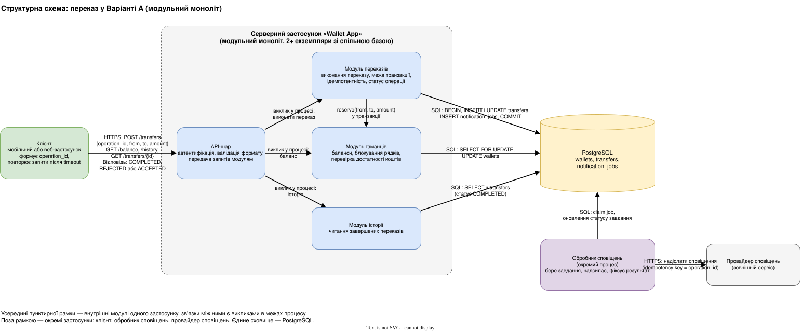
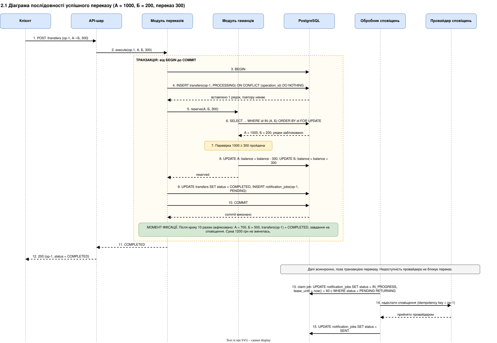
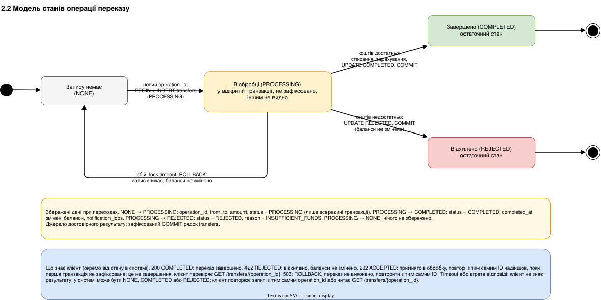
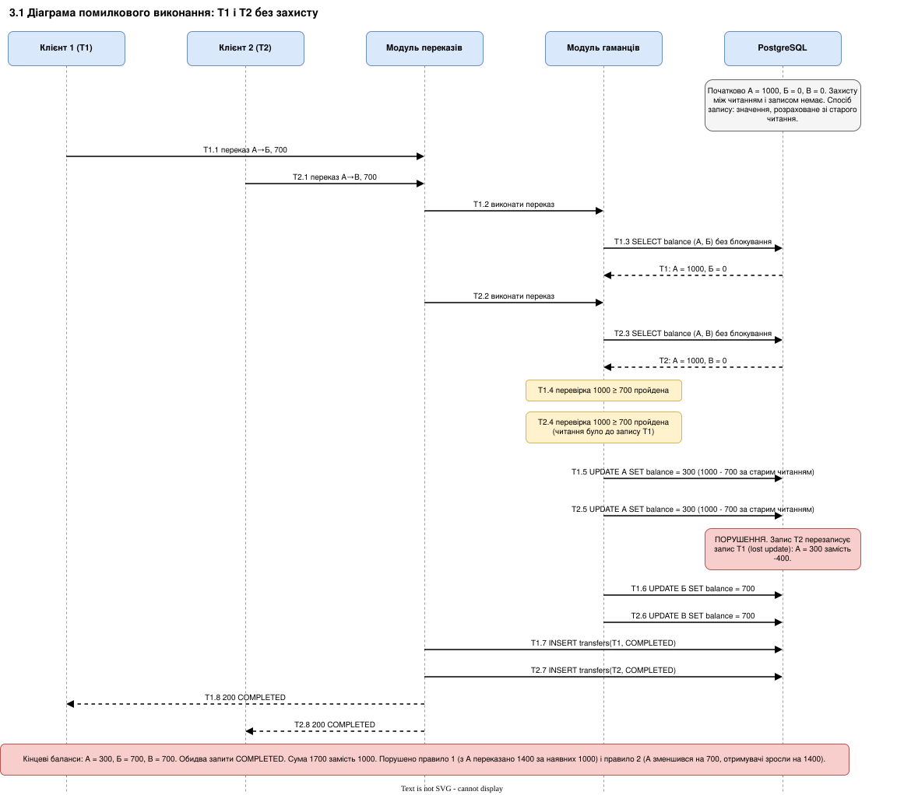
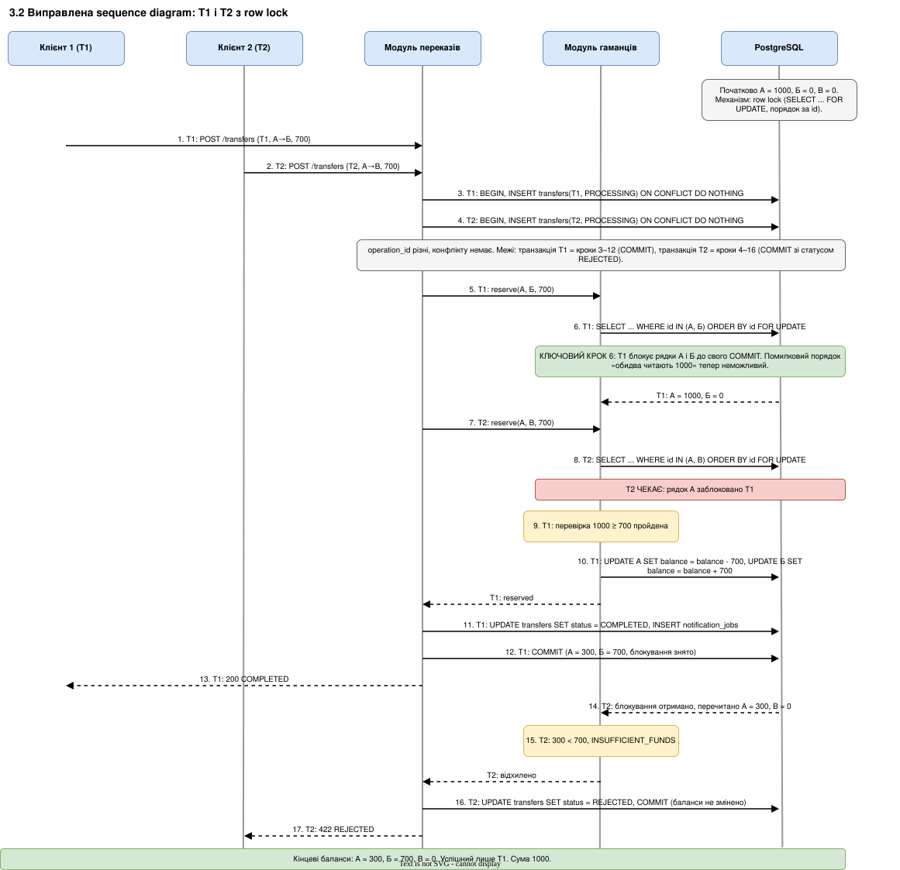

# Практична робота 1. Моделювання грошового переказу

**Заявлений рівень:** рівень 90+
**Автор:** Боярська Ірина

## 0. Обраний варіант

Основа моделей — **Варіант А, модульний моноліт**. Команда з 6 розробників має 3 місяці та досвід веброзробки й реляційних баз, але обмежений досвід підтримки розподілених систем. У варіанті А списання, зарахування, запис результату і завдання на сповіщення виконуються в одній транзакції PostgreSQL, тому атомарність забезпечує СУБД, а не протокол між сервісами. Проблема невизначеного результату після timeout між сервісами не виникає. Окремим процесом працює лише обробник сповіщень, який читає завдання з тієї самої бази.

---

## 1. Рівень 60

### 1.1 Структурна схема

Вузли всередині рамки Wallet App — внутрішні модулі одного застосунку, зв’язки між ними є викликами в межах процесу. Окремі застосунки: клієнт, Wallet App, обробник сповіщень, провайдер сповіщень. Окреме сховище: PostgreSQL.

### 1.2 Таблиця відповідальності

| Правило                                 | Відповідальний компонент                                                 | Дані та постійне сховище                                                                                                                | Запропонований механізм забезпечення                                                                                                                                                                                                                                                                              |
| --------------------------------------- | ------------------------------------------------------------------------ | --------------------------------------------------------------------------------------------------------------------------------------- | ----------------------------------------------------------------------------------------------------------------------------------------------------------------------------------------------------------------------------------------------------------------------------------------------------------------- |
| Захист від від’ємного балансу           | Модуль гаманців                                                          | PostgreSQL, таблиця `wallets(id, balance BIGINT, CHECK (balance >= 0))`; суми зберігаються в копійках                                   | Під час переказу `SELECT ... WHERE id IN (from, to) ORDER BY id FOR UPDATE` блокує рядки гаманців до COMMIT. Далі перевіряється `balance >= amount`. Якщо коштів недостатньо, списання не виконується, результат REJECTED. Обмеження `CHECK (balance >= 0)` у базі є останнім рубежем захисту.                    |
| Атомарність списання і зарахування      | Модуль переказів (координує транзакцію), Модуль гаманців (виконує зміни) | PostgreSQL: `wallets`, `transfers`, `notification_jobs` в одній базі                                                                    | Межа транзакції: від `BEGIN` до `COMMIT` у Модулі переказів. Усередині: INSERT запису `transfers`, блокування й перевірка, списання, зарахування, UPDATE `transfers` на COMPLETED, INSERT `notification_jobs`. Будь-який збій до COMMIT дає ROLLBACK, змін немає.                                                 |
| Захист від повторного виконання         | Модуль переказів                                                         | PostgreSQL, `transfers.operation_id` (UUID від клієнта) з обмеженням `UNIQUE`; поруч зберігаються `from`, `to`, `amount` для порівняння | Перший крок транзакції: `INSERT INTO transfers(operation_id, ...) ON CONFLICT (operation_id) DO NOTHING`. Якщо вставлено 0 рядків, це повтор: читається збережений запис і повертається його статус без нового списання. Якщо тим самим ID прийшли інші `from`, `to`, `amount`, повертається помилка 422.         |
| Збереження результату після перезапуску | Модуль переказів (запис), Модуль історії (читання)                       | PostgreSQL, `transfers(operation_id, from, to, amount, status, reason, completed_at)` на диску                                          | Статус COMPLETED або REJECTED записується в тій самій транзакції, що й зміни балансів. Відповідь клієнту надсилається лише після COMMIT (`synchronous_commit = on`, запис WAL на диск). Результат читається з бази за `operation_id` через `GET /transfers/{operation_id}`; застосунок стану в пам’яті не тримає. |

---

## 2. Рівень 75

### 2.1 Діаграма послідовності успішного переказу

Приклад: А = 1 000 грн, Б = 200 грн, переказ 300 грн, `operation_id = op-1`.

Балансова відповідь клієнту (крок 12) надсилається лише після COMMIT (крок 10). Якщо провайдер недоступний, кроки 13–15 повторюються пізніше, на переказ це не впливає.

### 2.2 Модель станів операції переказу

**Переходи, події та збережені дані**

NONE → PROCESSING. Подія: надійшов запит з новим `operation_id`, що пройшов перевірку формату (сума більша за нуль, `from` ≠ `to`, гаманці існують; інакше відповідь 400 без запису). Дані: рядок `transfers` з `operation_id`, `from`, `to`, `amount`, `status = PROCESSING`. Рядок існує лише всередині відкритої транзакції, поза нею його не видно.

PROCESSING → COMPLETED. Подія: гаманці заблоковано, `balance >= amount`, виконано списання й зарахування, COMMIT. Дані: `status = COMPLETED`, `completed_at`, змінені баланси, завдання в `notification_jobs`. Це момент зміни балансів і єдине джерело достовірного результату.

PROCESSING → REJECTED. Подія: після блокування `balance < amount`. Дані: `status = REJECTED`, `reason = INSUFFICIENT_FUNDS`, баланси не змінено, COMMIT.

PROCESSING → NONE. Подія: падіння застосунку або бази до COMMIT, помилка, lock timeout (300 мс), ROLLBACK. Дані: рядка `transfers` немає, баланси не змінено, жодного результату не збережено.

COMPLETED і REJECTED — остаточні стани. Джерело достовірного результату: рядок `transfers`, зафіксований COMMIT; історія показує тільки рядки зі статусом COMPLETED.

**Стан у системі та знання клієнта.** Клієнт знає лише те, що отримав у відповіді.

Відповідь 200 COMPLETED: переказ завершено, у системі стан COMPLETED.

Відповідь 422 REJECTED: переказ відхилено, баланси не змінено, у системі стан REJECTED.

Відповідь 202 ACCEPTED («прийнято в обробку»): повертається, коли повтор з тим самим `operation_id` прийшов, поки перша транзакція ще не зафіксована, і очікування вийшло за 300 мс. Це не означає завершення. Клієнт перевіряє результат через `GET /transfers/{operation_id}` або повторює запит з тим самим ID.

Відповідь 503: транзакцію відкочено (lock timeout), переказ не виконано, у системі стан NONE. Безпечно повторити з тим самим `operation_id`.

Timeout або втрата відповіді: клієнт не знає результату. У системі може бути NONE, COMPLETED або REJECTED, і timeout сам по собі цього не визначає. Клієнт повторює запит з тим самим `operation_id` (правило ідемпотентності повертає збережений результат або виконує переказ один раз) або читає `GET /transfers/{operation_id}`.

Механізм row lock із розділу 3.2 уже враховано в діаграмі 2.1 (крок 6) і моделі станів 2.2 (перехід PROCESSING → REJECTED), назви компонентів і станів у всіх діаграмах збігаються.

---

## 3. Рівень 90 і більше

### 3.1 Діаграма помилкового виконання

Умови: алгоритм «прочитати баланс → перевірити → списати → зарахувати → зберегти результат» без захисту між перевіркою і зміною. Початково А = 1 000, Б = 0, В = 0. T1: А → Б, 700. T2: А → В, 700. **Спосіб запису: кожен запит записує значення, розраховане зі старого читання** (`UPDATE wallets SET balance = <нове значення>`). Для наочності T1 і T2 показано на одних і тих самих учасниках, вони виконуються паралельно у двох потоках.

**Результат.** Кінцеві баланси: А = 300 грн, Б = 700 грн, В = 700 грн. Обидва запити отримали COMPLETED. Загальна сума зросла з 1 000 до 1 700 грн, тобто 700 грн виникли з нічого.

**Порушені правила.** Правило 1 «Користувач не може витратити більше коштів, ніж має»: з А переказано 1 400 грн за наявних 1 000 грн. Правило 2 «Завершений переказ зменшує баланс відправника і збільшує баланс отримувача на однакову суму»: баланс А зменшився на 700 грн, а баланси отримувачів зросли разом на 1 400 грн. Порушення відбулося на кроках T1.5 і T2.5 після того, як обидва запити пройшли перевірку на кроках T1.4 і T2.4 за однаковим старим читанням.

### 3.2 Виправлена sequence diagram

Ті самі T1 і T2, ті самі суми. Механізм: **row lock** (`SELECT ... FOR UPDATE`, рядки блокуються у порядку зростання `id`).

**Пояснення.** Захист забезпечує блокування рядків (row lock) через `SELECT ... FOR UPDATE`. На кроці 6 запит T1 отримує монопольне блокування рядка А до свого COMMIT, тому на кроці 8 запит T2 змушений чекати і не може прочитати старий баланс 1 000 грн паралельно з T1, а отже обидва запити не можуть успішно списати кошти. Після COMMIT T1 (крок 12) запит T2 отримує блокування, перечитує А = 300 грн, не проходить перевірку і фіксується зі статусом REJECTED на кроці 16 без зміни балансів, тож успішним є лише один переказ. Недолік механізму: рядок А залишається заблокованим до кінця транзакції T1, тому перекази з одного гаманця виконуються послідовно, час очікування зростає (запит може завершитися помилкою lock timeout), а взаємні блокування (deadlock) залишаються можливими, хоча фіксований порядок блокувань за `id` зменшує цей ризик.

### 3.3 Таблиця перевірки

| Сценарій                                                          | Початкові дані                                                                                             | Порядок дій або точка збою                                                                                                                    | Очікувані баланси та статуси                                                                                                                                                                                              | Механізм захисту                                                                                                                                                                  |
| ----------------------------------------------------------------- | ---------------------------------------------------------------------------------------------------------- | --------------------------------------------------------------------------------------------------------------------------------------------- | ------------------------------------------------------------------------------------------------------------------------------------------------------------------------------------------------------------------------- | --------------------------------------------------------------------------------------------------------------------------------------------------------------------------------- |
| Два різні перекази по 700 грн                                     | А = 1000, Б = 0, В = 0. T1: А→Б 700, T2: А→В 700, різні `operation_id`                                     | T1 виконує крок 6 (`FOR UPDATE` на А), T2 чекає, T1 робить COMMIT, T2 перечитує А (за діаграмою 3.2)                                          | А = 300, Б = 700, В = 0. T1 = COMPLETED (200), T2 = REJECTED (422, INSUFFICIENT_FUNDS). Сума 1000. Якщо першим виконається T2, симетрично: А = 300, Б = 0, В = 700                                                        | Row lock (`SELECT ... FOR UPDATE ORDER BY id`) + `CHECK (balance >= 0)`                                                                                                           |
| Повтор завершеного переказу з тим самим ID після втрати відповіді | А = 1000, Б = 200. `op-1`: А→Б 300 завершено й зафіксовано (А = 700, Б = 500), відповідь клієнту загублено | Клієнт після timeout повторює POST з `op-1`. `INSERT ... ON CONFLICT (operation_id) DO NOTHING` вставляє 0 рядків, система читає запис `op-1` | А = 700, Б = 500 (без змін). У `transfers` один запис `op-1`. Нового списання немає. Клієнт отримує 200 COMPLETED з тим самим результатом                                                                                 | `UNIQUE (operation_id)` у `transfers` + повернення збереженого результату                                                                                                         |
| Збій після списання, але до COMMIT                                | А = 1000, Б = 200. `op-1`: А→Б 300                                                                         | Транзакція виконала кроки 3–8 (в сесії А = 700), застосунок або база падає до кроку 10 (COMMIT) (за діаграмою 2.1)                            | Після відновлення А = 1000, Б = 200. Рядка `op-1` у `transfers` і завдання в `notification_jobs` немає, статусу COMPLETED немає. Клієнт отримує timeout, повторює `op-1` і переказ виконується один раз: А = 700, Б = 500 | Одна транзакція (атомарність), відкат незафіксованих змін під час відновлення PostgreSQL (WAL), статус COMPLETED записується лише в тій самій транзакції разом зі зміною балансів |

**Збереження даних після перезапуску.** PostgreSQL записує зафіксовані зміни у WAL на диск до того, як COMMIT буде підтверджено (`synchronous_commit = on`), тому після перезапуску відновлюються всі транзакції, підтверджені на кроці 10. Незафіксовані зміни відкидаються, блокування знімаються разом із розривом сесії. Екземпляри застосунку не зберігають стану операції в пам’яті, тож результат переказу завжди читається з рядка `transfers` за `operation_id`, а баланси — з `wallets`.
