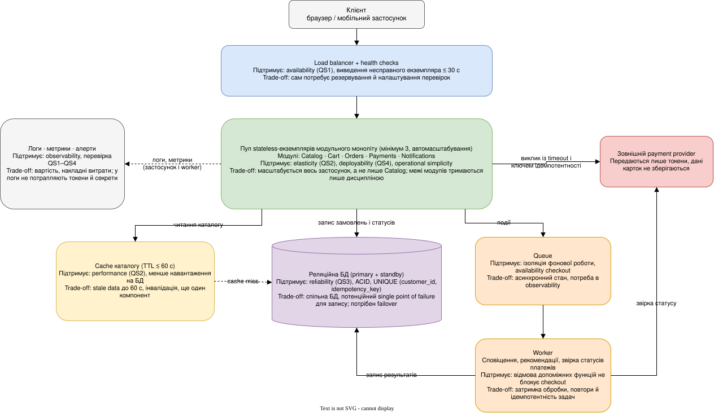
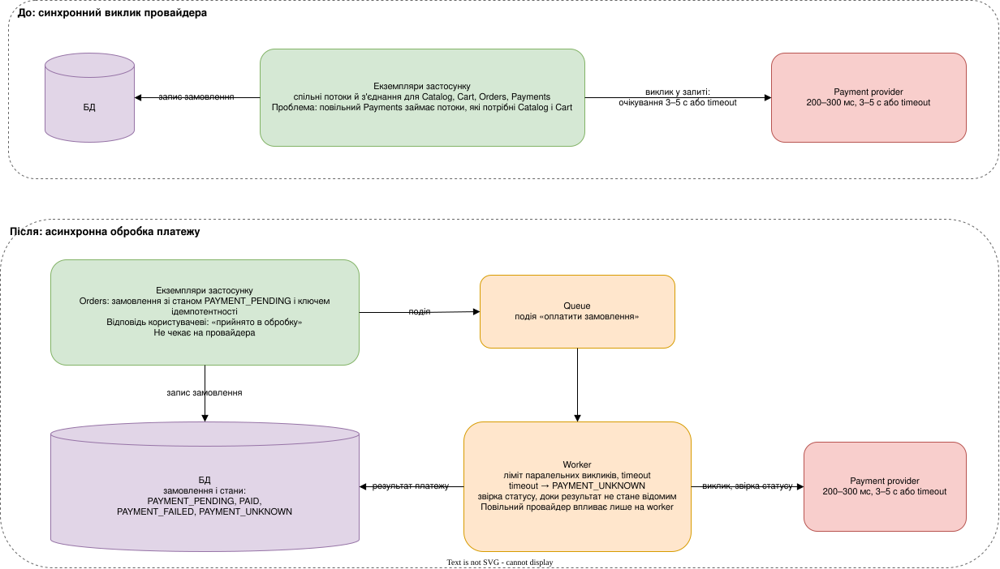

# Практична робота 2. Архітектурні характеристики, trade-offs та вимірювані сценарії

**Автор:** Боярська Ірина
**Заявлений рівень:** 90+

---

## 1. Рівень 60

### 1.1 Класифікація вимог і обмежень

Позначення: FR — functional requirement, AC — architectural characteristic, C — constraint, A/C — assumption/context.

1. «Користувачі переглядають каталог, працюють із кошиком, оформлюють замовлення, оплачують через провайдера, переглядають стан замовлення» — **FR**.
2. «Рекомендації й сповіщення є допоміжними функціями» — **FR**. Спірне: сама функція є функціональною, але слово «допоміжні» дає архітектурну вказівку, що їхня відмова не повинна зачіпати checkout.
3. «1 200 000 зареєстрованих користувачів» — **A/C**. Кількість реєстрацій не є характеристикою: архітектуру визначає одночасне навантаження, а не розмір бази користувачів.
4. «Звичайне навантаження близько 300 req/s, під час flash-sale 15–20 хвилин до 6 000 req/s (5 000 читань каталогу, 700 операцій із кошиком, 300 запитів оформлення або стану)» — **A/C**. Спірне: це профіль навантаження, а не характеристика. З нього випливають характеристики scalability і elasticity.
5. «7 розробників, 4 місяці до першого production-релізу» — **C**. Не є maintainability, лише підвищує значущість простоти експлуатації.
6. «Бюджет обмежений, постійно утримувати ресурси під абсолютний пік небажано» — **C** (вартість). З нього випливає потреба в elasticity, яка вже є характеристикою.
7. «Каталог може бути застарілим до 60 секунд» — **AC** (допустима eventual consistency каталогу). Спірне: це послаблення вимоги до свіжості даних, яке дозволяє кешування, тому воно класифіковане як характеристика-допуск, а не як функція.
8. «Рекомендації та email/push можуть бути недоступні й не блокують оформлення замовлення» — **AC** (fault isolation, що підтримує availability checkout).
9. «Замовлення та відомий системі результат платежу не зникають після перезапуску» — **AC** (reliability, durability).
10. «Повтор клієнтського запиту через timeout не створює дубль замовлення» — **FR** (бізнес-правило ідемпотентності). Спірне: правило функціональне, а характеристика, яку воно захищає, — reliability. Механізм реалізації (idempotency key) є рішенням, а не вимогою.
11. «Дані банківських карток не зберігаються, використовуються токени провайдера» — **C** (security, compliance). Спірне: обмеження, що зменшує зону відповідальності за безпеку, а не вимірювана властивість.
12. «Каталог: p95 ≤ 250 мс за 5 000 read req/s» — **AC** (performance з цільовим значенням).
13. «Після падіння одного екземпляра сервіс продовжує роботу без ручного втручання; втрата підтвердженого замовлення неприпустима» — **AC** (reliability, recoverability).
14. «Щонайменше 3 production-deployments на тиждень, rollback критичного дефекту до 10 хвилин» — **AC** (deployability).

### 1.2 Пріоритети architectural characteristics

Обрано п’ять характеристик.

**1. Reliability.**
Чому важлива: замовлення і результат платежу — гроші й зобов’язання перед клієнтом. Клієнти повторюють запити під час піків, тож повтор — штатна подія.
Якщо не виконати: дубль замовлення означає подвійне списання або подвійну відправку, втрата підтвердженого замовлення — прямий збиток і втрата довіри.
Конфлікти: з простотою й швидкістю. Сильна консистентність між Orders і Payments у розподіленому варіанті коштує складніших протоколів. Також конфліктує з перевагами каталогу, який свідомо eventual.

**2. Availability.**
Чому важлива: flash-sale — коротке вікно, де відбувається основний дохід. Ціль 99,95% на місяць означає не більше 21,6 хв простою за 30 днів (0,0005 × 43 200 хв). Вимога прямо виключає з розрахунку лише повну недоступність провайдера.
Якщо не виконати: checkout стає недоступним у вікні кампанії, коли відбувається основний дохід. Якщо допоміжні функції (рекомендації, сповіщення) не ізольовані, їхня відмова або повільна робота так само зупинить оформлення.
Конфлікти: з вартістю (запасні екземпляри, standby бази) і простотою (ізоляція вимагає додаткових компонентів: worker, ліміти, моніторинг).

**3. Performance і elasticity.**
Чому важлива: 5 000 із 6 000 req/s — читання каталогу, і ціль p95 ≤ 250 мс стосується саме піку. Бюджет не дозволяє тримати постійно ресурси під пік, тому потрібна elasticity.
Якщо не виконати: повільний каталог під час кампанії означає втрату покупців до оформлення замовлення. Постійна ємність під пік перевищує бюджет.
Конфлікти: з свіжістю даних (кеш означає до 60 с застарілості) і з вартістю (запас ресурсів), а також зі складністю (інвалідація кешу, автомасштабування).

**4. Deployability.**
Чому важлива: команда хоче ≥ 3 деплоїв на тиждень і rollback ≤ 10 хв, щоб швидко виправляти дефекти під час кампаній.
Якщо не виконати: дефект під час flash-sale неможливо швидко відкотити, а рідкі великі релізи збільшують ризик.
Конфлікти: з reliability даних (міграції схеми ускладнюють відкат) і з кількістю deployable-одиниць (більше сервісів означає більше pipeline і версійних залежностей).

**5. Observability.**
Чому важлива: частина роботи в цій системі відбувається асинхронно (фоновий worker, черга сповіщень, стан замовлення «прийнято в обробку» до отримання результату платежу), тому справжній стан системи не видно з одного запиту. Кеш каталогу може приховувати проблеми бази, доки кеш не промахнеться. Команда з 7 розробників має обмежений досвід експлуатації розподілених систем, а flash-sale триває лише 15–20 хвилин, тож шукати причину збою вручну немає часу. Крім того, без метрик неможливо перевірити в production сценарії QS1–QS4 (p95, error rate, cache hit ratio, час відкату) і запустити автомасштабування та rollback за сигналом.
Якщо не виконати: про збій worker або про деградацію платіжного провайдера дізнаються зі скарг користувачів. Замовлення з невідомим результатом платежу залишаються непоміченими. Rollback за 10 хвилин недосяжний, бо невідомо, коли саме його потрібно запускати.
Конфлікти: з вартістю (зберігання логів і метрик, інструменти моніторингу); з терміном і складом команди (4 місяці, 7 розробників: інструментація коду й налаштування алертів теж потребують часу); з performance (трейсинг і детальне логування додають накладні витрати, тому потрібен sampling); з безпекою (у логи не можна потрапляти токенам платежів, секретам і персональним даним).

### 1.3 Quality scenarios

**QS1. Availability**
Source / stimulus: аварійне завершення одного з екземплярів застосунку.
Artifact: Checkout (Orders і Payments у застосунку), load balancer.
Environment: flash-sale, checkout 250 req/s, працюють щонайменше три екземпляри (N + 1).
Response: load balancer виявляє несправний екземпляр, виводить із ротації, нові запити надходять на інші; клієнтські повтори з тим самим ключем завершуються успішно, ручне втручання не потрібне, підтверджені замовлення збережені.
Response measure: виявлення і виведення з ротації ≤ 30 с (health check кожні 10 с, 3 невдалі перевірки); частка помилкових відповідей checkout ≤ 5% у вікні виявлення і < 1% після нього; втрачених підтверджених замовлень — 0; місячна доступність checkout ≥ 99,95% (≤ 21,6 хв простою).

**QS2. Performance / elasticity (Catalog)**
Source / stimulus: початок flash-sale, читання каталогу зростає з 300 до 5 000 req/s протягом 2 хвилин (загальне навантаження до 6 000 req/s).
Artifact: Catalog (модуль у застосунку), кеш каталогу, пул екземплярів застосунку.
Environment: запланована кампанія; кеш прогрітий; автомасштабування налаштоване, мінімум екземплярів уже підвищено за розкладом перед стартом.
Response: система обслуговує читання з кешу й масштабує екземпляри без ручного втручання, checkout працює паралельно.
Response measure: p95 каталогу ≤ 250 мс на 5 000 req/s, помилок < 1%, cache hit ratio ≥ 95% (≤ 250 req/s доходить до бази), завантаження CPU екземплярів < 70% (headroom ≥ 30%), стабільність дотримується протягом усіх 20 хвилин піку.

**QS3. Reliability**
Source / stimulus: клієнт, не отримавши відповіді, повторює `POST /orders` з тим самим idempotency key до трьох разів за 5 секунд, у тому числі одночасно; між COMMIT і відповіддю падає екземпляр.
Artifact: Orders (модуль), таблиця `orders` з обмеженням `UNIQUE (customer_id, idempotency_key)` у PostgreSQL.
Environment: checkout 250 req/s, штатний режим.
Response: система повертає вже створене замовлення з тим самим станом, нового не створює; після перезапуску застосунку чи бази підтверджені замовлення і відомий статус платежу збережені.
Response measure: 0 дублів замовлень на 10 000 повторів у навантажувальному тесті; 0 втрачених підтверджених замовлень після примусового перезапуску екземпляра і failover бази; повернення збереженого результату з p95 ≤ 800 мс.

**QS4. Deployability**
Source / stimulus: розробник зливає зміну в main, CI/CD випускає її у production; після деплою виявляється критичний дефект.
Artifact: застосунок (єдиний deployable) і pipeline.
Environment: робочі години, звичайне навантаження, міграції схеми виконані за схемою expand/contract (зворотно сумісні).
Response: rolling deployment без простою; відкат до попереднього образу без ручної зміни даних.
Response measure: ≥ 3 production-deployments на тиждень; час від рішення про відкат до повернення метрик у норму ≤ 10 хв; 0 ручних операцій із даними під час відкату; перевіряється deployment rehearsal щомісяця.

---

## 2. Рівень 75

### 2.1 Trade-off matrix

Порівнюються Варіант А (модульний моноліт) і Варіант Б (окремі сервіси Catalog, Orders, Payments). Importance і оцінки: 1–5, де 5 означає найкраще для цього кейсу.

| Критерій                                          | Importance | Варіант А | Rationale А                                                                                                                                                                  | Варіант Б | Rationale Б                                                                                                                                                    |
| ------------------------------------------------- | ---------- | --------- | ---------------------------------------------------------------------------------------------------------------------------------------------------------------------------- | --------- | -------------------------------------------------------------------------------------------------------------------------------------------------------------- |
| Reliability (унікальність замовлення, durability) | 5          | 5         | Замовлення, ключ ідемпотентності й статус платежу записуються в одній ACID-транзакції. Обмеження `UNIQUE (customer_id, idempotency_key)` гарантує відсутність дублів.        | 3         | Orders і Payments мають власні дані, тому потрібні outbox/saga й обробка часткових відмов. Це вимагає складнішого протоколу й досвіду, якого в команди обмаль. |
| Availability checkout (QS1)                       | 5          | 4         | Мінімум три stateless-екземпляри за load balancer переживають падіння одного. Ризики: спільна БД і дефект в одному модулі, який може зачепити весь застосунок.               | 4         | Відмова Catalog чи сповіщень не зупиняє Orders, ізоляція краща. Водночас з'являються мережеві виклики між сервісами, і кожен є новим failure mode.             |
| Performance / elasticity Catalog (QS2)            | 4          | 3         | Кеш каталогу з TTL ≤ 60 с знімає більшість читань, а екземпляри масштабуються автоматично. Але масштабується весь застосунок, зокрема код Cart і Orders, а це зайві ресурси. | 5         | Catalog масштабується незалежно від Orders, ресурси використовуються точніше. Кеш усе одно потрібен.                                                           |
| Deployability (QS4)                               | 4          | 4         | Один artifact і один pipeline, rollback означає повернення попереднього образу за хвилини. Мінус: усі модулі випускаються разом.                                             | 3         | Сервіси випускаються незалежно, але потрібні кілька pipeline, узгодження версій API і координований rollback. Ціль ≤ 10 хв складніше гарантувати.              |
| Observability                                     | 3          | 4         | Єдиний потік логів і менше мережевих переходів, причину збою знайти простіше. Асинхронність обмежена одним worker.                                                           | 2         | Для відстеження одного замовлення потрібні розподілений tracing, кореляційні ідентифікатори й агрегація логів з кількох сервісів.                              |
| Operational complexity / cost of operation        | 5          | 5         | Один runtime, менше компонентів і мережевих failure modes. Підходить для 7 розробників із обмеженим досвідом розподілених систем і терміну 4 місяці.                         | 2         | Більше deployables, брокер, мережеві таймаути, повтори й телеметрія. Постійна вартість експлуатації вища за бюджетні обмеження першого релізу.                 |

Підсумок за зваженою сумою (importance × оцінка, максимум 130): Варіант А — 110, Варіант Б — 83.

Перевірка критичних характеристик: жоден варіант не отримав оцінку 1–2 за reliability чи availability checkout, тобто сумарний бал не приховує провалу. Найнижча оцінка Варіанта А — performance (3). Вона закривається кешем і автомасштабуванням (QS2) і не є провалом. Найнижча оцінка Варіанта Б — operational complexity (2) при importance 5, це головна причина не обирати його для першого релізу. Залишковий ризик Варіанта А — спільна БД як single point of failure для запису. Він знижується standby-реплікою з автоматичним failover і перевіряється в QS3.

### 2.2 Схема обраної архітектури (Варіант А)

### 2.3 ADR-001. Модульний моноліт як архітектура першого релізу FlashShop

**Context**
FlashShop має профіль навантаження з піком до 6 000 req/s протягом 15–20 хвилин, з яких близько 5 000 req/s — читання каталогу. Звичайне навантаження — близько 300 req/s. Команда складається з 7 розробників, до релізу 4 місяці, досвід експлуатації розподілених систем обмежений, бюджет не дозволяє постійно тримати ресурси під пік, перший реліз працює в одному cloud-region. Головні drivers: reliability замовлення (QS3), availability checkout (QS1), performance каталогу (QS2) і deployability (QS4). Рішення прийнято зараз, бо від архітектури залежать план розробки й інфраструктура наступних чотирьох місяців.

**Decision**
Обрано Варіант А: модульний моноліт із модулями Catalog, Cart, Orders, Payments і Notifications. Він розгортається як кілька однакових stateless-екземплярів за load balancer, використовує спільну реляційну БД із standby, кеш каталогу з TTL ≤ 60 с і окремий worker із queue для сповіщень, рекомендацій та звірки платежів. Унікальність замовлення забезпечується обмеженням `UNIQUE (customer_id, idempotency_key)`. За матрицею (розділ 2.1) Варіант А отримав 110 балів проти 83 для Варіанта Б.

**Alternatives considered**

- Варіант Б (окремі сервіси Catalog, Orders, Payments). Відхилено для першого релізу: оцінки 2 за operational complexity (importance 5) і 3 за reliability (importance 5) через міжсервісну консистентність, більше pipeline і складніший tracing. Перевага — незалежне масштабування Catalog (оцінка 5).
- Варіант А без кешу й worker. Відхилено: 5 000 read req/s на базу не дозволяє виконати QS2, а синхронна відправка сповіщень поставила б availability checkout у залежність від допоміжних функцій (QS1).

**Consequences**

- Позитивні: один deployable і rollback за хвилини (QS4); транзакційна цілісність замовлення без розподілених протоколів (QS3); менше компонентів і простіший tracing; швидший вихід у реліз.
- Негативні: масштабується весь застосунок, а не лише Catalog; кеш додає stale data до 60 с та інвалідацію; worker і queue додають асинхронний стан, що потребує observability; спільна БД залишається точкою ризику для запису; усі модулі випускаються разом.

**Risks / unknowns**

- Cache hit ratio ≥ 95% — припущення, яке потрібно підтвердити навантажувальним тестом (QS2).
- Час автоматичного failover БД невідомий, його потрібно виміряти під час перевірки QS3.
- Автомасштабування може не встигнути за ростом навантаження за 2 хвилини; пом'якшення — підвищення мінімуму екземплярів за розкладом перед кампанією.
- Межі модулів можуть розмитися (прямий доступ до чужих таблиць), що ускладнить подальше виділення сервісів.
- Міграції схеми можуть зробити rollback неможливим без ручної зміни даних, якщо порушувати expand/contract.

**Умови перегляду рішення**
Рішення варто переглянути, якщо суттєво зростає команда й виникає потреба в незалежних релізах окремих частин; якщо вартість масштабування всього застосунку заради Catalog стає непропорційною; якщо Payments потребує ізоляції через надійність інтеграції або вимоги безпеки; якщо система переходить на кілька cloud-regions.

---

## 3. Рівень 90+

### 3.1 Stress scenario B — нестабільний Payment Provider

| Пункт                        | Відповідь                                                                                                                                                                                                                                                                                                                                                                                                                                          |
| ---------------------------- | -------------------------------------------------------------------------------------------------------------------------------------------------------------------------------------------------------------------------------------------------------------------------------------------------------------------------------------------------------------------------------------------------------------------------------------------------- |
| Початкове рішення            | Модульний моноліт: кілька stateless-екземплярів за load balancer, спільна БД, кеш каталогу, worker із queue для фонових задач. Модуль Payments викликає провайдера з тих самих екземплярів застосунку, що обслуговують Catalog і Cart.                                                                                                                                                                                                             |
| Змінена умова                | Протягом 15 хвилин провайдер відповідає то за 200–300 мс, то за 3–5 с, а частина запитів завершується timeout. Користувач не повинен випадково створити друге замовлення.                                                                                                                                                                                                                                                                          |
| Architectural characteristic | Availability (повільна зовнішня залежність не повинна зупиняти інші частини системи) і reliability (поведінка при невідомому результаті платежу).                                                                                                                                                                                                                                                                                                  |
| Що стало проблемою           | Синхронний виклик провайдера з обробника запиту утримує потік і з'єднання на 3–5 с. Верхня оцінка для 250 req/s checkout: 250 × 5 с ≈ 1 250 одночасних викликів. Пули потоків і з'єднань спільні для всього моноліту, тому повільний Payments уповільнює Catalog і Cart, а checkout ризикує перевищити p95 ≤ 800 мс. Timeout залишає невідомий результат, який легко помилково показати як помилку.                                                |
| Рішення залишаємо / змінюємо | Архітектурний варіант (модульний моноліт) залишаємо. Змінюємо спосіб взаємодії з провайдером.                                                                                                                                                                                                                                                                                                                                                      |
| Одна архітектурна зміна      | Винести виклик провайдера з обробника запиту в уже наявні queue і worker. Orders у транзакції БД зберігає замовлення в стані `PAYMENT_PENDING` разом з ключем ідемпотентності і повертає «прийнято в обробку». Worker викликає провайдера з обмеженою кількістю паралельних викликів і timeout. При timeout стан стає `PAYMENT_UNKNOWN`, а звірка запитує в провайдера фактичний статус за збереженим посиланням, доки результат не стане відомим. |
| Новий trade-off              | Остаточний результат оплати з'являється із затримкою, користувач бачить проміжний стан. З'являються машина станів замовлення і процес звірки, тож потрібна observability (довжина черги, кількість замовлень у `PAYMENT_UNKNOWN`). Рішення спирається на можливість запитати у провайдера статус платежу.                                                                                                                                          |

### 3.2 Відповіді на питання сценарію

**Яку architectural characteristic перевіряє цей сценарій?**
Availability: повільна зовнішня залежність не повинна зупиняти Catalog, Cart та інші частини. Reliability: система має коректно поводитися, коли результат платежу невідомий.

**Що означає timeout для системи: відому помилку чи невідомий результат?**
Невідомий результат. Timeout означає лише те, що відповідь не надійшла вчасно, а провайдер міг встигнути виконати платіж. Тому timeout не можна трактувати як «платіж не пройшов» і дозволяти створення нового замовлення чи повторне списання. Замовлення переходить у `PAYMENT_UNKNOWN`, а остаточний стан визначається звіркою.

**Що має побачити користувач?**
Повідомлення «Замовлення прийнято, оплата обробляється» з номером замовлення та сторінку статусу. Не показується «Оплата не пройшла, спробуйте ще раз» із кнопкою, яка створює нове замовлення. Якщо користувач повторить запит або оновить сторінку, ключ ідемпотентності повертає те саме замовлення з його поточним станом. Після визначення результату замовлення переходить у `PAID` або `PAYMENT_FAILED`, а користувач отримує сповіщення.

**Чи повинна повільна робота Payment Provider блокувати інші частини системи?**
Ні. У початковому рішенні такий ризик є, бо виклик відбувається в пулі, спільному з Catalog і Cart. Після зміни повільний провайдер впливає лише на worker, а обробники запитів швидко повертають стан із БД.

**Яку одну архітектурну зміну ви внесли б?**
Асинхронна обробка платежу: виклик провайдера виконує worker через queue, а запит користувача завершується станом «прийнято в обробку». Це відповідає вимозі умови: p95 ≤ 800 мс до повернення однозначного результату або стану «прийнято в обробку».

### 3.3 Схема до / після

### 3.4 Перевірка рішення

Перевірка fault injection: тестовий заступник провайдера імітує затримки 3–5 с і timeout протягом 15 хвилин. Очікування: p95 каталогу залишається ≤ 250 мс; p95 відповіді checkout ≤ 800 мс зі станом «прийнято в обробку»; 0 дублів замовлень при повторах із тим самим ключем; після відновлення провайдера кількість замовлень у `PAYMENT_UNKNOWN` зменшується до 0.

### 3.5 Межі рішення і розрізнення фактів та припущень

Факти з умови: профіль відповідей провайдера (200–300 мс, 3–5 с, timeout) протягом 15 хвилин; заборона дубля замовлення; checkout 250 req/s; p95 ≤ 800 мс до однозначного результату або стану «прийнято в обробку».

Припущення: провайдер дозволяє запитати статус платежу за посиланням і приймає ключ ідемпотентності; оцінка 1 250 одночасних викликів є верхньою межею (усі 250 req/s містять виклик провайдера); значення timeout і ліміту паралельних викликів у worker підбираються за результатами тесту.

Межі: рішення перестає бути виправданим, якщо провайдер не надає способу дізнатися статус платежу (тоді звірка неможлива і потрібне ручне опрацювання або інший провайдер). Опозиційне рішення — виділити Payments в окремий сервіс із власними ресурсами — стає виправданим, якщо обсяг платежів зростає настільки, що одного worker із лімітами недостатньо, або якщо вимоги безпеки чи окрема команда Payments вимагають ізольованого deployment.
