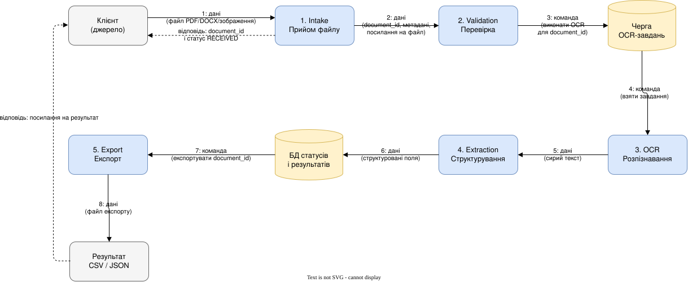
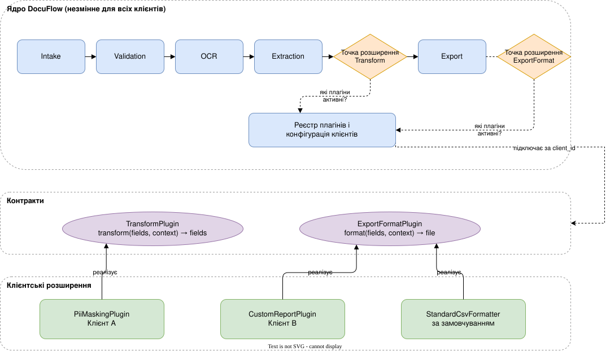
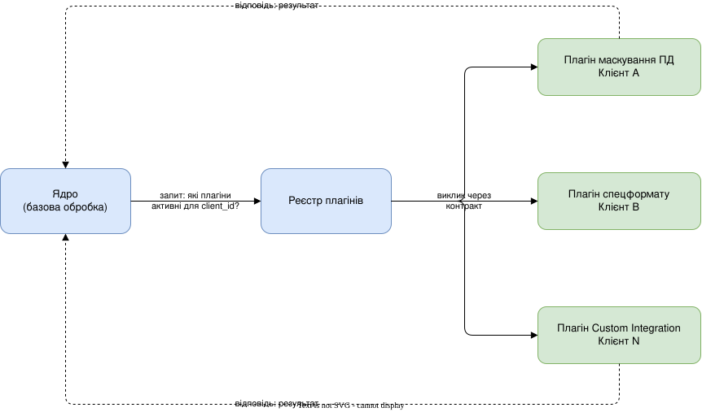
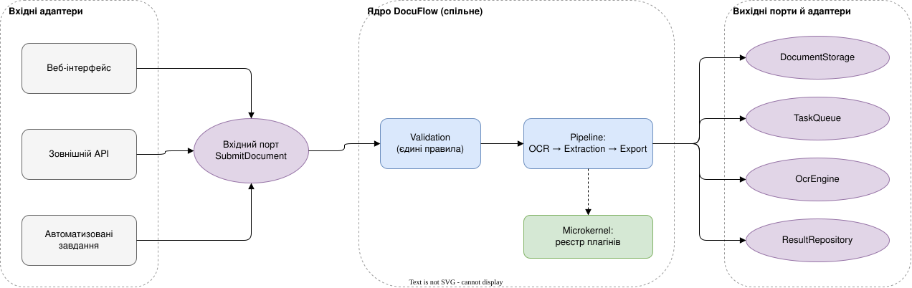
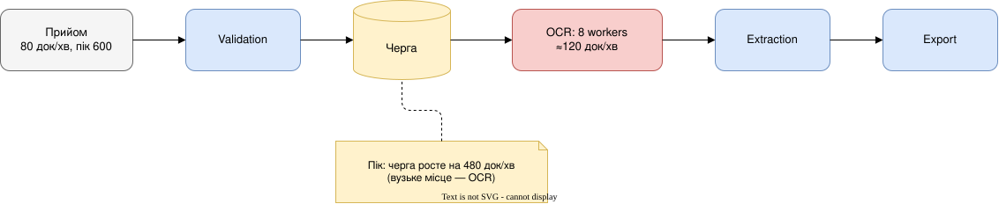
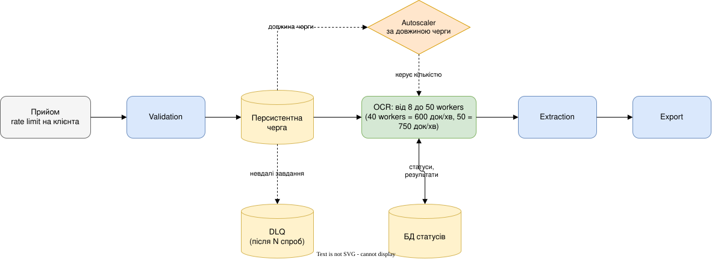
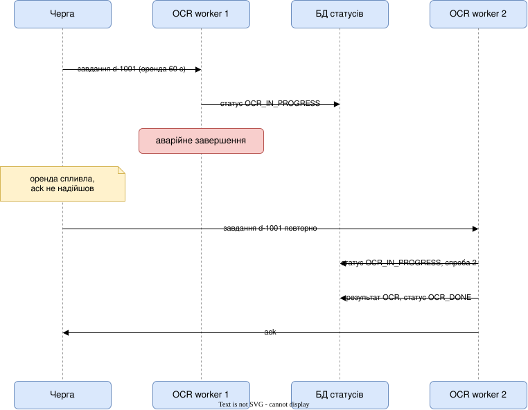

# Практична робота 5. Архітектурні стилі: проєктування, розширення та масштабування системи

**Автор:** Боярська Ірина

# Рівень 60

## 1. Вибір архітектурного стилю

### Pipeline (Pipes and Filters)

- Механізм: система складається з фільтрів (кожен виконує одне перетворення) і каналів (pipes), які передають результат одного фільтра на вхід наступного в одному напрямку. Порядок фільтрів визначений структурою системи.
- Що організовує в DocuFlow: основний процес «завантаження → перевірка → розпізнавання → структурування → експорт».
- Підходить, бо документ послідовно перетворюється: файл → перевірений файл → текст → структуровані поля → експортований файл. Кожен етап має чітку відповідальність, вхід і вихід, етапи можна тестувати окремо й масштабувати незалежно (наприклад, OCR).
- Обмеження: стиль описує потік даних, але не описує, як додавати специфічну поведінку для окремих клієнтів. Для цього потрібен інший стиль.

### Layered

- Механізм: компоненти групуються в горизонтальні шари (презентація, бізнес-логіка, доступ до даних), кожен шар викликає лише сусідній нижчий.
- Що міг би організувати: внутрішню структуру окремих сервісів (наприклад, веб-інтерфейс → прикладна логіка → репозиторій).
- Для основного процесу не підходить: шари розділяють технічні відповідальності, а не етапи перетворення даних. Документ не «спускається» через шари, він послідовно змінює форму. Використання Layered для всього процесу змішало б етапи в одному шарі «бізнес-логіки».

### Hexagonal (Ports & Adapters)

- Механізм: ядро застосунку ізольоване від зовнішнього світу через порти (інтерфейси), а адаптери підключають до портів конкретні технології та канали входу.
- Що міг би організувати: межу між ядром обробки та зовнішнім світом (вхідні канали, сховища, OCR-рушій).
- Для основного процесу не підходить: він не описує порядок і перетворення даних усередині ядра. Це стиль про ізоляцію ядра, а не про потік обробки. Стане важливим у сценарії A.

### Microkernel

- Механізм: мінімальне ядро з базовою функціональністю та реєстр плагінів, які підключаються через визначені контракти.
- Що міг би організувати: клієнтські розширення Enterprise та Custom Integration (приховування персональних даних, спеціальні формати експорту).
- Для основного процесу не підходить: Standard-сценарій має фіксовану послідовність етапів, а не набір взаємозамінних можливостей. Але стиль добре підходить для варіативності між клієнтами.

### Space-Based Architecture

- Механізм: стан і обробка розподіляються по багатьох процесорних одиницях, дані живуть у розподіленій in-memory сітці (data grid), що усуває центральну БД як вузьке місце.
- Що міг би організувати: систему з екстремальною та непередбачуваною конкурентністю на спільних даних (наприклад, аукціон, квитки).
- Для основного процесу не підходить: навантаження DocuFlow — обчислювальне (OCR), а не конкуренція за спільні дані. Статуси мають зберігатися після перезапуску, а in-memory сітка додає складність синхронізації та відновлення.

### Підсумок: композиція стилів

- Pipeline — основний процес обробки документа.
- Microkernel — клієнтські розширення.
- Hexagonal — підключення нових способів входу.
- Layered — внутрішня структура окремих компонентів.
- Space-Based — не застосовується.

---

## 2. Архітектурна схема стандартної обробки



### Відповідальність етапів

1. **Intake (прийом).** Приймає файл, зберігає в об'єктному сховищі, створює запис документа зі статусом `RECEIVED`, повертає клієнту `document_id`. Не аналізує зміст.
2. **Validation (перевірка).** Перевіряє формат (PDF, DOCX, зображення), розмір, пошкодженість, відсутність дублікату. Некоректний документ отримує статус `REJECTED` з причиною, інші документи не зачіпає.
3. **OCR (розпізнавання).** Бере завдання з черги, читає файл за посиланням, повертає сирий текст. Ресурсомісткий етап (4 с на документ), тому працює через чергу та масштабується окремо.
4. **Extraction (структурування).** Виділяє з тексту поля (ім'я клієнта, номер рахунку, сума, дата), нормалізує формат, перевіряє наявність обов'язкових полів.
5. **Export (експорт).** Перетворює структуровані дані в потрібний формат (у Standard — CSV або JSON) і зберігає файл для завантаження.

### Що передається по стрілках

- Стрілка 1 — **дані**: файл документа.
- Стрілка 2 — **дані**: `document_id`, ім'я файлу, тип, розмір, посилання на файл у сховищі.
- Стрілка 3 — **команда**: «виконати OCR для `document_id`». Це повідомлення в черзі, воно не містить сам файл.
- Стрілка 4 — **команда**: воркер забирає завдання з черги.
- Стрілка 5 — **дані**: сирий текст і метадані розпізнавання.
- Стрілка 6 — **дані**: структуровані поля, які записуються в БД.
- Стрілка 7 — **команда**: «експортувати результат для `document_id`».
- Стрілка 8 — **дані**: файл експорту.
- Пунктирні стрілки — **відповіді** клієнту: підтвердження прийому зі статусом і посилання на результат.

---

## 3. Модель виконання одного документа

Документ: рахунок. Клієнт — «ТОВ Ромашка», номер рахунку `INV-2026-00417`, сума `12 450,00 UAH`, дата операції `2026-11-05`. Файл `invoice.pdf`, 1 сторінка.

### Етап 1. Intake

- **Вхід:** файл `invoice.pdf` від клієнта.
- **Перетворення:** файл зберігається у сховищі, створюється запис документа.
- **Вихід:** `{document_id: "d-1001", file_ref: "storage://d-1001/invoice.pdf", type: "pdf", status: "RECEIVED"}`.

### Етап 2. Validation

- **Вхід:** запис `d-1001` із посиланням на файл.
- **Перетворення:** перевірка формату, розміру, цілісності. Статус змінюється на `VALIDATED`, у чергу ставиться завдання.
- **Вихід:** `{document_id: "d-1001", status: "VALIDATED"}` і повідомлення в черзі `{task: "ocr", document_id: "d-1001"}`.

### Етап 3. OCR

- **Вхід:** завдання з черги та файл `invoice.pdf`.
- **Перетворення:** воркер розпізнає текст (≈4 с). Статус `OCR_IN_PROGRESS`, потім `OCR_DONE`.
- **Вихід:** сирий текст: `"Рахунок INV-2026-00417 від 05.11.2026. Платник: ТОВ Ромашка. До сплати: 12 450,00 грн"`.

### Етап 4. Extraction

- **Вхід:** сирий текст.
- **Перетворення:** виділення полів, нормалізація суми (`12450.00`) і дати (`2026-11-05`), перевірка обов'язкових полів. Статус `EXTRACTED`.
- **Вихід:** `{client_name: "ТОВ Ромашка", invoice_number: "INV-2026-00417", amount: 12450.00, currency: "UAH", operation_date: "2026-11-05"}`.

### Етап 5. Export

- **Вхід:** структуровані поля.
- **Перетворення:** серіалізація у CSV, збереження файлу. Статус `EXPORTED`.
- **Вихід:** файл `d-1001.csv`:

```
client_name,invoice_number,amount,currency,operation_date
ТОВ Ромашка,INV-2026-00417,12450.00,UAH,2026-11-05
```

Клієнт отримує посилання на результат.

**Помилка одного документа:** якщо `d-1002` зламаний, він отримує статус `REJECTED` або `FAILED` на своєму етапі. Решта документів у черзі обробляється далі.

---

# Рівень 75

## 1. Корпоративні розширення

### Архітектура

Композиція стилів: **Pipeline** (основний процес) + **Microkernel** (механізм розширень).

- Ядро містить базові етапи Pipeline, реєстр плагінів і конфігурацію клієнтів.
- У ядрі визначено **точки розширення** — місця в процесі, де можна підключити плагін: `TransformPlugin` (після Extraction, перед Export) і `ExportFormatPlugin` (замість стандартного форматера на етапі Export).
- Плагін реалізує контракт точки розширення та реєструється в реєстрі. Реєстр за `client_id` вирішує, які плагіни активні.
- Клієнт A: плагін `PiiMaskingPlugin` (`TransformPlugin`). Клієнт B: плагін `CustomReportPlugin` (`ExportFormatPlugin`).



### Компоненти

- **Базова функціональність (ядро):** Intake, Validation, OCR, Extraction, базовий Export, черга, БД статусів.
- **Механізм підключення:** реєстр плагінів + точки розширення.
- **Контракти:** `TransformPlugin` (вхід і вихід — структуровані поля та контекст клієнта) і `ExportFormatPlugin` (вхід — поля, вихід — файл). Плагін не звертається до внутрішніх компонентів ядра, лише до даних контракту.
- **Клієнтські розширення:** `PiiMaskingPlugin` (A), `CustomReportPlugin` (B).
- **Незмінні компоненти:** усі етапи Pipeline, черга, сховища, API статусів. Для нового клієнта додається лише плагін і запис у конфігурації.

## 2. Pipeline та Microkernel

### Що є етапом, а що розширенням

- **Етап обробки даних** — обов'язкова частина процесу, що перетворює дані й виконується для кожного документа (Validation, OCR, Extraction, Export).
- **Розширення функціональності** — необов'язкова можливість, яку підключають для конкретного клієнта через контракт (приховування персональних даних, спеціальний формат звіту).

### Хто визначає порядок і хто обирає розширення

- Порядок етапів визначає **структура Pipeline**: у DocuFlow це оркестрація ядра, яка веде документ від етапу до етапу.
- Розширення обирає **реєстр плагінів ядра Microkernel** за конфігурацією клієнта. Саме плагін порядок не визначає.

### Чи може плагін додати новий етап

Так. Наприклад, `PiiMaskingPlugin` фактично додає крок «маскування» між Extraction і Export. Але це не робить стилі тотожними:

- Місце плагіна в послідовності задає ядро через точку розширення. Плагін не вирішує, де він виконується.
- Плагін вмикається лише для певних клієнтів і може бути відсутнім, а етап Pipeline обов'язковий для кожного документа.
- Pipeline відповідає на питання «у якій послідовності перетворюємо дані», Microkernel — «як додати можливість без зміни ядра».
- У Pipeline незалежність забезпечують контракти входу й виходу фільтрів. У Microkernel — контракти між ядром і плагінами, тут ядро знає про плагін лише через інтерфейс.

### Таблиця порівняння

| Критерій                         | Pipeline                            | Microkernel                              |
| -------------------------------- | ----------------------------------- | ---------------------------------------- |
| Головне питання                  | У якому порядку перетворюються дані | Як додати можливість без зміни ядра      |
| Основні елементи                 | Фільтри та канали (pipes)           | Ядро, реєстр плагінів, контракти         |
| Хто визначає порядок             | Структура конвеєра                  | Ядро (плагін лише в точці розширення)    |
| Хто обирає виконуваний компонент | Ніхто, усі етапи виконуються        | Реєстр за конфігурацією клієнта          |
| Обов'язковість компонента        | Обов'язковий для кожного документа  | Необов'язковий, підключається за потреби |
| Напрямок потоку                  | Односторонній                       | Ядро викликає плагін і отримує відповідь |
| Приклад у DocuFlow               | OCR → Extraction → Export           | `PiiMaskingPlugin` для клієнта A         |
| Типова зміна                     | Додати чи замінити етап у процесі   | Додати плагін для нового клієнта         |

### Схема 1. Pipeline: послідовне перетворення даних


Кожен етап приймає результат попереднього та передає свій наступному. Відсутність будь-якого етапу ламає ланцюжок.

### Схема 2. Microkernel: підключення можливості



Тут немає послідовності між плагінами. Це набір незалежних можливостей, які ядро викликає вибірково за конфігурацією клієнта.

## 3. Метрики результату

**Технічні**

1. **Час підключення корпоративного розширення** (людино-дні від початку задачі до розгортання плагіна).
   - Вимірювання: за трекером задач — від створення задачі до релізу плагіна.
   - Зв'язок з архітектурою: контракти й точки розширення мають скоротити цей час, бо ядро не змінюється.
2. **Частка успішно оброблених документів** (`EXPORTED` / усі прийняті, за період).
   - Вимірювання: підрахунок статусів у БД.
   - Зв'язок з архітектурою: ізоляція етапів і збоїв означає, що помилка одного документа чи плагіна не зупиняє решту.

**Продуктові / бізнесові**

3. **Використання платних можливостей** (частка Enterprise-клієнтів, що використовують хоча б одне розширення щомісяця).
   - Вимірювання: журнал активації плагінів по клієнтах.
   - Зв'язок з архітектурою: легкість підключення має збільшити охоплення можливостей.
4. **Дохід від корпоративних пакетів** (сума щомісячних платежів за Enterprise та Custom Integration).
   - Вимірювання: дані білінгу.
   - Зв'язок з архітектурою: швидше підключення розширень дозволяє продавати більше корпоративних пакетів без розробки окремого застосунку.

---

# Рівень 90

## Сценарій A. Нова зовнішня інтеграція

### Чи потрібно змінювати поточну архітектуру

Так, але локально. Основний процес (Pipeline) і Microkernel залишаються. Змінюється **межа системи**: тепер документи надходять через вебінтерфейс, зовнішній API та автоматизовані завдання, і всі канали мають застосовувати однакові правила перевірки й обробки. Тому між каналами входу та ядром потрібен вхідний порт.

Дублювати весь процес для кожного каналу не можна. Це створило б три копії правил перевірки, які з часом розійдуться, і втричі збільшило б вартість будь-якої зміни.

### Де доречно використати Ports & Adapters

- **Вхідний порт** `SubmitDocument` — єдиний інтерфейс прийому документа. Приймає файл, `client_id` і параметри; повертає `document_id` та статус.
- **Вхідні адаптери:** веб-адаптер (завантаження через інтерфейс), REST API-адаптер (зовнішня система документообігу), адаптер планових завдань (batch-імпорт з папки або за розкладом). Кожен адаптер лише перетворює свій формат запиту у виклик порту, без бізнес-правил.
- **Вихідні порти:** `DocumentStorage`, `TaskQueue`, `OcrEngine`, `ResultRepository`. Їхні адаптери — об'єктне сховище, брокер черги, конкретний OCR-рушій, БД. Це дозволяє замінити технологію, не чіпаючи ядро.



### Змінені та незмінні компоненти

**Змінені / нові**

- Вхідний порт `SubmitDocument` (новий).
- API-адаптер і адаптер автоматизованих завдань (нові).
- Веб-інтерфейс переведений на виклик порту замість прямого виклику Intake.
- Автентифікація та облік клієнта (`client_id`) на рівні адаптерів.

**Незмінні**

- Validation, OCR, Extraction, Export.
- Microkernel: реєстр плагінів, контракти, плагіни клієнтів.
- Черга, БД статусів, сховище файлів.

### Метрики

- **Технічна: збіг результатів перевірки між каналами входу.** Той самий набір тестових документів (коректні, пошкоджені, завеликі, неправильного формату) надсилається через веб-інтерфейс, зовнішній API та автоматизовані завдання. Метрика — частка документів, для яких результат перевірки однаковий у всіх трьох каналах. Вимірювання: контрактні тести. Очікуване значення: 100%. Зв'язок з архітектурою: єдиний вхідний порт і спільна Validation у ядрі не дають адаптерам мати власні правила, тому розбіжність сигналізує про дублювання перевірок в адаптері.
- **Продуктова:** кількість документів, що надходять через зовнішній API від корпоративних клієнтів (або кількість клієнтів з активною інтеграцією). Вимірювання: журнал адаптерів за каналами. Очікуваний зв'язок: можливість підключення без змін ядра відкриває новий сегмент клієнтів.

---

## Сценарій B. Зростання навантаження

### Теоретична пропускна здатність початкового OCR

- Один worker: 1 документ / 4 с = 0,25 документа за секунду.
- 8 workers: 8 × 0,25 = **2 документи за секунду**, тобто **120 документів за хвилину**.

Порівняння з навантаженням:

- Звичайне навантаження 80 док/хв < 120 док/хв: запас є, завантаження OCR ≈ 80 / 120 ≈ 67%.
- Пікове навантаження 600 док/хв > 120 док/хв: потужності вистачає лише на 20% потоку.

### Вузьке місце

Вузьке місце — **OCR-компонент**: найповільніший етап (4 с), тоді як решта етапів значно швидші. Нерозрахована потужність приводить до зростання черги.

Наслідок для 10-хвилинного піку (припущення):

- Надходить 600 × 10 = 6 000 документів, обробляється 120 × 10 = 1 200.
- Черга зростає на 480 док/хв, тобто до 4 800 документів наприкінці піку.
- Після піку при 80 док/хв надходження вільна потужність становить 120 − 80 = 40 док/хв, тож черга розсмоктується приблизно 4 800 / 40 = 120 хв.

Потрібна кількість workers для піку: 600 док/хв = 10 док/с; 10 × 4 с = **40 workers** при 100% завантаженні. На практиці потрібен запас (накладні витрати, нерівномірність), наприклад 48–50 workers.

### Спосіб масштабування

- **Горизонтальне масштабування OCR workers** з автоматичним збільшенням їхньої кількості залежно від довжини черги (autoscaling): мінімум 8, максимум близько 50.
- **Черга як буфер** між Validation та OCR: приймаємо документи миттєво, обробляємо з керованою швидкістю.
- **Backpressure:** обмеження розміру черги й швидкості прийому на клієнта (rate limit), щоб один клієнт не заблокував решту.
- Масштабувати слід **лише OCR**, а не весь застосунок: Intake, Validation, Extraction та Export не є вузьким місцем. Масштабування всього застосунку було б дорожчим і не прискорило б OCR.

### Схеми до та після

**До**



**Після**


### Чи потрібна Space-Based Architecture

- **Яку задачу вирішує:** усуває центральну БД чи сховище як вузьке місце при дуже великій конкурентності на спільних даних, зберігаючи стан у розподіленій in-memory сітці.
- **Чи виправдана для DocuFlow: ні, на цьому етапі.**
  - Вузьке місце — обчислення (OCR), а не доступ до спільних даних. Його розв'язує масштабування workers із чергою.
  - Вимога «статуси зберігаються після перезапуску» суперечить стану лише в пам'яті; довелося б додавати синхронізацію з БД.
  - Складність (data grid, реплікація, узгодженість) висока для команди з 6 розробників і 4 місяців.
- Стала б корисною, якби вузьким місцем стали читання й запис статусів (наприклад, на порядки більше документів і клієнтів, або жорсткі вимоги до затримки відповіді).

### Збереження стану завдань після аварії OCR worker

- Стан документа зберігається в БД (`QUEUED`, `OCR_IN_PROGRESS`, `OCR_DONE`, `FAILED`), а не в пам'яті worker.
- Черга персистентна. Worker бере завдання з **орендою (lease / visibility timeout)** і підтверджує його (**ack**) лише після запису результату OCR.
- Якщо worker аварійно завершився, ack не надійшов: після спливу оренди завдання повертається в чергу, і його бере інший worker. Зафіксований результат не втрачається.
- **Ідемпотентність:** повторна обробка того самого `document_id` не створює дубліката (результат записується за ключем `document_id` + етап).
- **Обмеження повторів:** після N невдалих спроб завдання йде в чергу недоставлених (DLQ), документ отримує `FAILED`. Інші документи не страждають.



---

## Технічна перевірка рішення

| Ситуація                     | Очікувана поведінка                                          | Компонент і механізм                                                                                           | Як перевірити                                                                                                                                                                                           |
| ---------------------------- | ------------------------------------------------------------ | -------------------------------------------------------------------------------------------------------------- | ------------------------------------------------------------------------------------------------------------------------------------------------------------------------------------------------------- |
| Звичайний документ           | Документ проходить необхідні етапи та отримує результат      | Pipeline: Intake → Validation → черга → OCR → Extraction → Export; статуси в БД                                | Завантажити тестовий `invoice.pdf`, перевірити послідовність статусів `RECEIVED` → `EXPORTED` і відповідність полів у CSV (`INV-2026-00417`, `12450.00`, `2026-11-05`)                                  |
| Збій OCR worker              | Завдання можна відновити без втрати зафіксованого результату | Персистентна черга з lease і ack після запису результату; статуси в БД; ідемпотентний запис; DLQ після N спроб | Примусово зупинити worker під час обробки; переконатися, що завдання повернулося в чергу, оброблене іншим worker, дублікатів результату немає, раніше збережені результати інших документів на місці    |
| Масове одночасне надходження | Система контролює навантаження, завдання не губляться        | Черга як буфер, rate limit на клієнта, autoscaling OCR за довжиною черги                                       | Надіслати 6 000 документів за 10 хв; перевірити, що кількість прийнятих = кількість у кінцевих статусах (`EXPORTED`, `REJECTED`, `FAILED`), черга росте контрольовано, а кількість workers збільшується |

---
