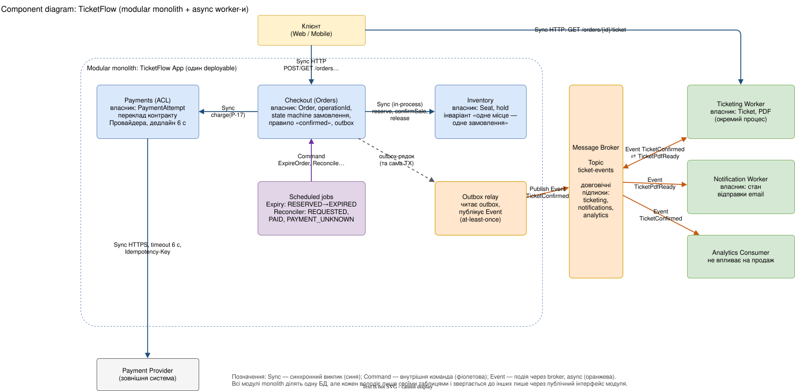
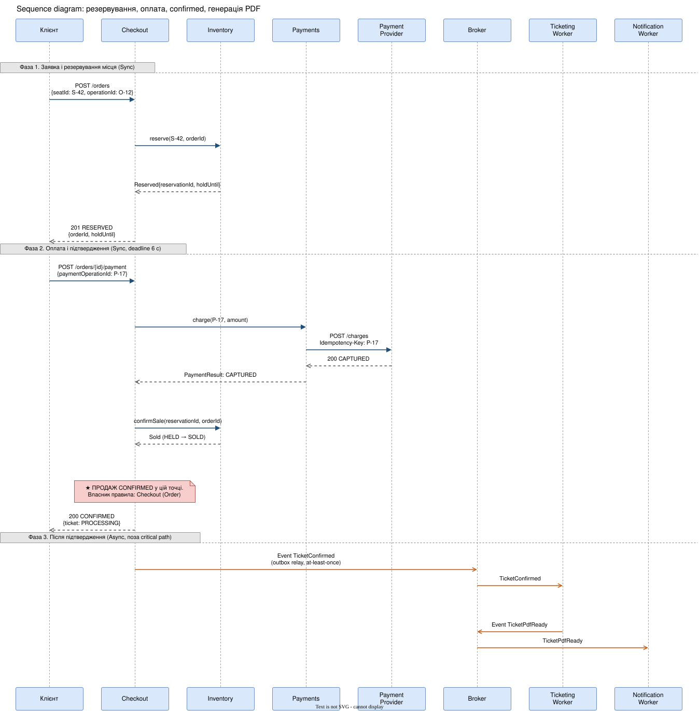
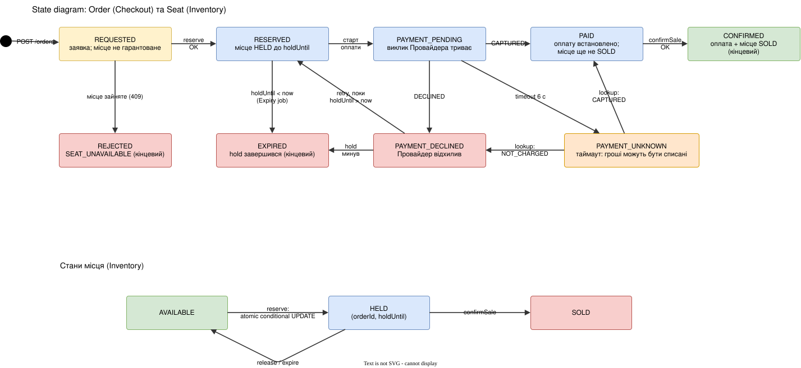
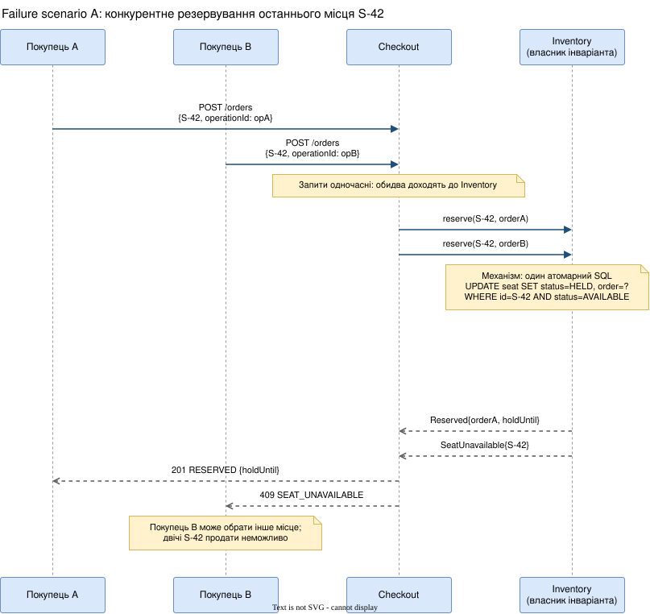
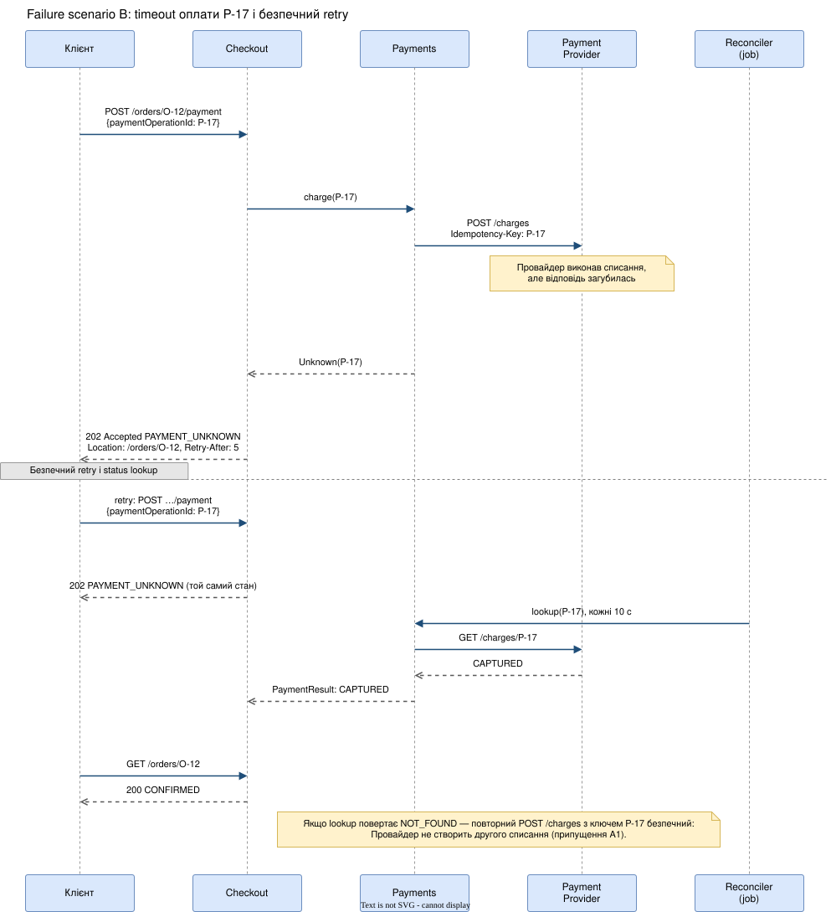

# Практична робота 6. Communication & Integration Patterns: TicketFlow

Автор: Боярська Ірина

## Припущення

- A1. Payment Provider підтримує `Idempotency-Key` (повторний `POST /charges` з тим самим ключем не створює другого списання і повертає результат першого) та status lookup `GET /charges/{key}` зі статусами `CAPTURED`, `DECLINED`, `NOT_FOUND`.
- A2. Є одна реляційна БД із транзакціями та row-level locking; брокер повідомлень надає довговічні підписки та доставку at-least-once (можливі дублікати).
- A3. Дедлайн виклику Провайдера — 6 с. Невизначені платежі перевіряє Reconciler кожні 10 с; якщо невизначеність триває понад 15 хв, система створює алерт для оператора.

---

# Рівень 60

## 1. Архітектурне рішення і межа підтвердження

Обрано змішану модель на основі модульного моноліту (6 розробників, 3 місяці). Резервування місця та оплата виконуються синхронно, бо клієнт має одразу знати, чи місце за ним, а `confirmed` не можна повідомити без достовірного результату оплати. Генерація PDF, email та analytics виконуються асинхронно через outbox і брокер, бо вони не є умовами продажу. Deployables: застосунок TicketFlow App (модулі Checkout, Inventory, Payments, scheduled jobs) і worker-процеси Ticketing, Notification, Analytics. Навантаження навчального сценарію (1000 клієнтів за хвилину, ≈17 запитів/с) не потребує асинхронного резервування.

Таблиця ключових взаємодій:

| Мета                                                                 | Sync / Async                                                              | Семантика результату                                                                                  | Залежність / ризик                                                                             | Бізнесове обґрунтування                                                                                   |
| -------------------------------------------------------------------- | ------------------------------------------------------------------------- | ----------------------------------------------------------------------------------------------------- | ---------------------------------------------------------------------------------------------- | --------------------------------------------------------------------------------------------------------- |
| Клієнт → Checkout: створити замовлення і зарезервувати місце         | Sync (HTTP)                                                               | `201 RESERVED` — місце гарантовано утримується до `holdUntil`; `409 SEAT_UNAVAILABLE` — місце зайняте | Checkout залежить від доступності Inventory/БД; при збої — `503`, замовлення не створюється    | Клієнт одразу знає результат; не потрібно обіцяти місце, якого немає                                      |
| Checkout → Inventory: reserve, confirmSale, release                  | Sync (in-process виклик публічного інтерфейсу модуля)                     | Відповідь — факт зміни стану місця, а не намір                                                        | Temporal: Inventory має відповісти; Behavioral: Checkout покладається на семантику `holdUntil` | Інваріант «одне місце — одне замовлення» потребує одного власника й негайної відповіді                    |
| Checkout → Payments → Provider: оплата                               | Sync із дедлайном 6 с; при timeout — перехід до статусу `PAYMENT_UNKNOWN` | `CAPTURED`, `DECLINED` або `UNKNOWN`; timeout не означає, що гроші не списано                         | Залежність від гарантій Провайдера (A1); затримка до 5 с                                       | `confirmed` можна повідомити лише після достовірного результату; типова відповідь 200 мс дає найкращий UX |
| З'ясування невизначеного результату: Reconciler і `GET /orders/{id}` | Async (job із періодичним lookup + polling клієнта)                       | Статус змінюється з `PAYMENT_UNKNOWN` на `PAID`/`CONFIRMED` або на `PAYMENT_DECLINED`                 | Місце залишається HELD, поки результат невідомий; потрібен алерт при затяжній невизначеності   | Не списати гроші двічі й не продати місце, за яке могли заплатити                                         |
| Checkout → Broker → Ticketing: генерація PDF                         | Async (Event `TicketConfirmed` через outbox)                              | Подія фіксує факт продажу; доставка at-least-once                                                     | Затримка 3–8 с; можливі дублікати; Ticketing мусить бути ідемпотентним                         | PDF не є умовою продажу; повільна операція не блокує клієнта                                              |
| Broker → Notification та Analytics                                   | Async (Pub/Sub, окремі підписки)                                          | `TicketPdfReady` і `TicketConfirmed` — факти для споживачів                                           | Відставання й дублікати; збій споживача не впливає на продаж                                   | Email та analytics не є умовами підтвердження; ізоляція збоїв                                             |

**Що означає відповідь клієнту.**

- `201 RESERVED` — заявку прийнято і місце гарантовано утримується до `holdUntil`. Це не підтвердження продажу.
- `200 CONFIRMED` — оплата достовірно `CAPTURED` і місце `SOLD` за цим замовленням. PDF може ще генеруватися (`ticket: PROCESSING`).
- `202 Accepted` з `PAYMENT_UNKNOWN` — результат оплати невідомий; відповідь містить `Location: /orders/{id}` і `Retry-After`. Місце при цьому лишається HELD (поле `reservation.state`).
- `202 Accepted` з `REQUESTED` — заявка прийнята, але місце ще не гарантоване (трапляється лише при повторі запиту, поки перший ще виконується, або після збою). Назви `REQUESTED` і `RESERVED` не змішуються.
- `409 SEAT_UNAVAILABLE` / `409 RESERVATION_EXPIRED`, `402 PAYMENT_DECLINED`, `503` — відмови з однозначним значенням.

**Critical path.** До відповіді про оплату мають завершитися: перевірка `operationId` → умовний перехід `RESERVED → PAYMENT_PENDING` → виклик Провайдера → збереження результату → `confirmSale` у Inventory → транзакція `CONFIRMED` + запис outbox. Кожна операція входить у critical path, бо без неї не можна достовірно стверджувати «оплачено і місце моє». Генерація PDF, email та analytics у critical path не входять.

**Як клієнт дізнається остаточний результат.** Отримавши `202`, клієнт опитує `GET /orders/{id}` з інтервалом `Retry-After` (5 с). Паралельно Reconciler кожні 10 с виконує lookup платежу. Відповідь `GET` містить `status` і окреме поле `reservation.state`.

## 2. Coupling у власному рішенні

### Залежність 1: Checkout → Inventory (Structural, Temporal, Behavioral)

Фрагмент контракту модуля Inventory (єдина точка входу):

```
interface InventoryApi {
  reserve(seatId, orderId, ttl = 10min) -> Reserved{reservationId, holdUntil} | SeatUnavailable
  confirmSale(reservationId, orderId)   -> Sold | NotHeld
  release(reservationId)                -> Released          // ідемпотентно
}
```

- Structural: Checkout не імпортує `InventoryRepository` і не читає таблицю `seat`; залежність обмежена інтерфейсом `InventoryApi` (контролюється правилом архітектурних тестів). Заміна внутрішньої моделі місць не змінює Checkout.
- Temporal: виклик синхронний, тому при недоступному Inventory Checkout не може створити замовлення і повертає `503`; нічого не резервується і не списується.
- Behavioral / Contract: Checkout вважає `Reserved` гарантією утримання до `holdUntil`. Якщо Inventory змінить семантику `holdUntil` або додасть новий результат (наприклад, `Waitlisted`), Checkout треба змінити, бо інакше він покаже клієнту неправильний статус.

Чому залишено: резервування є ядром інваріанта й потребує негайної відповіді. Асинхронний варіант зняв би temporal coupling, але змусив би давати клієнту `pending` без гарантії місця.

### Залежність 2: Checkout → Payment Provider через Payments (Temporal, Behavioral, Structural)

Фрагмент контракту Провайдера (за припущенням A1):

```
POST /charges   Idempotency-Key: P-17   {amount, currency, orderRef}
  -> 200 {status: CAPTURED | DECLINED}  |  timeout (результат невідомий)
GET  /charges/P-17
  -> {status: CAPTURED | DECLINED | NOT_FOUND}
```

- Temporal: Checkout чекає до 6 с. Якщо Провайдер недоступний або повільний, оплата не завершується, замовлення лишається `RESERVED` (до спливу `holdUntil`) або переходить у `PAYMENT_UNKNOWN`.
- Behavioral / Contract: система вважає, що timeout ≠ failure і що `Idempotency-Key` запобігає повторному списанню. Якщо Провайдер змінить гарантії ідемпотентності, повторний запит може створити друге списання.
- Structural: SDK та формат Провайдера знає лише модуль Payments (anti-corruption layer). Checkout працює з власними результатами `CAPTURED`, `DECLINED`, `UNKNOWN`.

Послаблено: залежності від Ticketing, Notification і Analytics — вони підписані на події і не впливають на продаж. Залишається behavioral coupling до payload `TicketConfirmed`: споживачі покладаються на поля `orderId`, `seatId`, `eventId`.

## 3. Component diagram і альтернатива



Відповідальності та володіння станом:

- Checkout володіє `Order`, `operationId`, state machine замовлення, правилом «confirmed» та outbox.
- Inventory володіє `Seat` і hold; єдиний власник інваріанта «одне місце — одне замовлення».
- Payments володіє `PaymentAttempt` і є anti-corruption layer до Провайдера.
- Scheduled jobs (Expiry, Reconciler) не мають власного бізнес-стану; вони надсилають Checkout команди `ExpireOrder` і `ReconcilePayment`.
- Outbox relay читає outbox і публікує події в брокер.
- Ticketing володіє `Ticket` і PDF, Notification — станом відправки email, Analytics лише споживає події.

Характер взаємодій: Client→Checkout, Checkout→Inventory, Checkout→Payments, Payments→Provider — Sync; Jobs→Checkout — Command; Relay→Broker→споживачі — Event (async).

**Альтернатива: Async reservation** (клієнт отримує `202 PENDING`, команда `ReserveSeat` ставиться в чергу, результат клієнт отримує polling-ом).

Переваги обраного рішення:

1. Клієнт отримує остаточну відповідь за мілісекунди (`201` або `409`), без polling і без стану «чекайте».
2. Менше рухомих частин на критичному шляху (немає брокера в резервуванні): простіше довести інваріант і реалізувати за 3 місяці командою з 6 розробників.

Недоліки та додаткові витрати обраного рішення:

1. Temporal coupling: на піку запити чекають на row lock в Inventory, потоки HTTP заблоковані; потрібні дедлайни і bulkhead.
2. Синхронний виклик Провайдера тримає запит до 6 с; на вищому навантаженні потрібно обмежувати кількість одночасних платежів.
3. Немає природного буфера для різких сплесків.

Бізнес-умова для зміни вибору: якщо піковий трафік зросте до рівня (наприклад, десятки тисяч одночасних клієнтів), за якого p95 резервування перевищує бізнес-ціль, або якщо бізнес погодиться на статус очікування замість негайної відповіді, резервування варто перевести в async-чергу з чергою очікування.

---

# Рівень 75

## 1. Sequence diagram обраного варіанта



Момент, після якого продаж `confirmed`: транзакція Checkout, у якій `Order → CONFIRMED` і запис outbox виконуються після того, як платіж `CAPTURED`, а Inventory підтвердив `confirmSale` (місце `SOLD`). Власник правила — Checkout (агрегат `Order`). До цього моменту клієнт отримує лише `RESERVED`, `PAYMENT_UNKNOWN` або `PAID` (не остаточні).

Альтернативний сценарій (протилежний вибір: резервування Async):

| Крок | Що відбувається                                                               | Що бачить клієнт                         |
| ---- | ----------------------------------------------------------------------------- | ---------------------------------------- |
| 1    | `POST /orders` → Checkout ставить Command `ReserveSeat` в чергу               | `202 PENDING` (місце не гарантоване)     |
| 2    | Inventory обробляє черги послідовно, фіксує `SeatReserved` або `SeatRejected` | нічого, клієнт опитує `GET /orders/{id}` |
| 3    | Checkout оновлює Order                                                        | через секунди `RESERVED` або `REJECTED`  |
| 4    | Оплата стартує лише після `RESERVED`                                          | додатковий крок очікування               |

Новий trade-off для бізнесу: піки згладжуються, Inventory масштабується окремо, але до ≈700 із 1000 клієнтів відмова доходить із затримкою, зростає навантаження на polling, з'являються додаткові статуси і пара Command/Event для резервування.

## 2. Семантика Command / Event та доставка роботи

**Command `ReserveSeat`**

- Producer: Checkout. Consumer: Inventory.
- Payload: `{seatId: "S-42", orderId: "O-12"}`.
- Виражає намір: «зарезервуй місце». Гарантії, що місце вільне, немає. Доставка — прямий in-process виклик (`InventoryApi.reserve`), не повідомлення через брокер, бо потрібна негайна відповідь.

**Event `TicketConfirmed`**

- Producer: Checkout (через outbox). Consumers: Ticketing і Analytics.
- Payload: `{eventId: "E-901", orderId: "O-12", seatId: "S-42", confirmedAt: ...}`; `eventId` — унікальний ідентифікатор повідомлення для дедуплікації.
- Виражає факт: система зафіксувала продаж. Email ще може бути не надісланий і PDF ще може не існувати.

Також використовується Event `TicketPdfReady` (producer: Ticketing; consumer: Notification; факт: PDF створено і доступний за посиланням).

`ReserveSeat` не може вважатися `SeatReserved`: Command — прохання, яке Inventory може відхилити; Event — факт, уже зафіксований власником стану.

**Вибір доставки: Pub/Sub із довговічними підписками** (topic `ticket-events`, окрема підписка для кожного споживача). Обґрунтування: одну подію мають отримати кілька незалежних споживачів із різною швидкістю (PDF 3–8 с, email, analytics), додавання нового споживача не змінює Checkout. Черга (Queue) була б достатньою, якби був єдиний споживач; прямий виклик — якби робота була швидкою і не мусила переживати перезапуск worker. Чому не прямий виклик: повільна генерація PDF (3–8 с) і збій Ticketing не повинні впливати на продаж, а перезапуск worker не повинен губити роботу.

Надійність публікації: запис `TicketConfirmed` в outbox відбувається в тій самій транзакції, що й `CONFIRMED`; relay публікує подію щонайменше один раз. Дублікати обробляються ідемпотентно: Ticketing має унікальний індекс `ticket(orderId)`, інші споживачі ведуть таблицю `processed_events(eventId)`.

## 3. State model і клієнтський контракт



Розрізнення понять:

- заявка — `REQUESTED` (місце не гарантоване);
- успішне резервування — `RESERVED` (місце HELD);
- результат оплати — `CAPTURED` (стан `PAID`), `DECLINED` (`PAYMENT_DECLINED`) або невідомий (`PAYMENT_UNKNOWN`);
- остаточне підтвердження — `CONFIRMED`;
- відхилення — `REJECTED` (місце зайняте), `PAYMENT_DECLINED`; завершення строку — `EXPIRED`.

Правила переходів:

- Усі переходи Order виконуються умовним оновленням (`... WHERE status = <очікуваний>`), тому Expiry job і старт оплати не можуть виграти одночасно.
- Expiry застосовується лише в `RESERVED`. У `PAYMENT_PENDING`, `PAYMENT_UNKNOWN`, `PAID` місце не звільняється, бо гроші могли бути списані.
- `PAYMENT_DECLINED → RESERVED` (повторна спроба з новим `paymentOperationId`) можливий, поки `holdUntil > now`; інакше `EXPIRED`.
- Станам `REQUESTED` більше ніж 30 с і `PAID` більше ніж 30 с відновлює Reconciler: повторює ідемпотентні `reserve` або `confirmSale`. Якщо `confirmSale` поверне `NotHeld` (не очікується, бо hold заморожено), створюється алерт і ручне повернення коштів.

Клієнтський контракт (приклади відповідей):

```
201 Created            {"orderId":"O-12","status":"RESERVED","reservation":{"state":"HELD","holdUntil":"..."}}
202 Accepted           {"orderId":"O-12","status":"PAYMENT_UNKNOWN","reservation":{"state":"HELD"},
                        "check":"/orders/O-12","retryAfter":5}
200 OK                 {"orderId":"O-12","status":"CONFIRMED","ticket":{"status":"PROCESSING"}}
409 Conflict           {"error":"SEAT_UNAVAILABLE","seatId":"S-42"}
```

`202 Accepted` означає лише, що запит прийнято до опрацювання; він не підтверджує ні платіж, ні продаж. Гарантію місця виражає окреме поле `reservation.state = HELD` (і статус `RESERVED` у `201`). Повтор `POST /orders` із тим самим `operationId` повертає збережений результат першого запиту (унікальний ключ на `operationId`), повтор оплати з тим самим `paymentOperationId` не створює нового платежу. Після `CONFIRMED` клієнт отримує PDF через `GET /orders/{id}/ticket` (повертає `202`, поки PDF не готовий) або з email.

---

# Рівень 90+

## Failure scenario A: конкурентне резервування S-42



Власник інваріанта — Inventory. Механізм — атомарне умовне оновлення в одному SQL-операторі:
`UPDATE seat SET status='HELD', order_id=?, hold_until=? WHERE id='S-42' AND status='AVAILABLE'`.
БД серіалізує два оновлення одного рядка (row lock): перше змінює 1 рядок, друге після очікування бачить `status='HELD'` і змінює 0 рядків. Результат `rowsAffected = 0` Inventory перетворює на `SeatUnavailable`. Покупець A отримує `201 RESERVED`, покупець B — `409 SEAT_UNAVAILABLE` і може обрати інше місце. Повторний `reserve` для того самого `orderId` після збою повертає той самий `Reserved`, тому retry не створює другого hold.

## Failure scenario B: payment timeout і retry



Що знає система: платіж P-17 надіслано, відповіді немає, тому результат невідомий (не `FAILED`). Клієнт отримує `202 PAYMENT_UNKNOWN` із шляхом перевірки `/orders/O-12`. Повторний запит клієнта з тим самим `paymentOperationId = P-17` не створює нового платежу: Checkout бачить існуючий attempt і повертає поточний стан. Reconciler виконує lookup `GET /charges/P-17`: `CAPTURED` → `PAID` → `CONFIRMED`; `DECLINED` → `PAYMENT_DECLINED`; `NOT_FOUND` → безпечний повторний `POST /charges` з тим самим ключем.

Залежність від гарантій Провайдера: безпека retry повністю тримається на припущенні A1 (idempotency key і status lookup). Без цих гарантій другого списання уникнути не можна, і система мусила б повертати кошти вручну.

## Таблиця перевірки

| Початковий стан                                | Збій                                                | Відповідь клієнту                                                                  | Механізм захисту                                                                               | Залишковий ризик                                                                                                                                |
| ---------------------------------------------- | --------------------------------------------------- | ---------------------------------------------------------------------------------- | ---------------------------------------------------------------------------------------------- | ----------------------------------------------------------------------------------------------------------------------------------------------- |
| S-42 `AVAILABLE`, два одночасні запити         | Конкурентне резервування                            | A: `201 RESERVED`; B: `409 SEAT_UNAVAILABLE`                                       | Атомарне умовне оновлення в Inventory (row lock); ідемпотентний `reserve` за `orderId`         | Покупець A може не заплатити — місце недоступне B до спливу hold (до 10 хв + лаг Expiry ≈10 с); конкуренція за «гарячий» рядок збільшує latency |
| Order `PAYMENT_PENDING`, платіж P-17 надіслано | Provider списав кошти, відповідь втрачена (timeout) | `202 PAYMENT_UNKNOWN` + `Location` і `Retry-After`; після lookup — `200 CONFIRMED` | `Idempotency-Key` P-17; lookup перед повтором; unique `paymentOperationId`; заморожений expiry | Залежність від гарантій Провайдера (A1); місце заблоковане, доки результат невідомий; при невизначеності >15 хв потрібен оператор               |

## ADR-001

- Context: 1000 клієнтів за першу хвилину борються за 300 місць; Provider відповідає за 200 мс–5 с або з timeout; PDF генерується 3–8 с; команда — 6 розробників, 3 місяці; клієнт має одразу знати, чи місце за ним, а `confirmed` не можна давати без достовірного результату оплати.
- Decision: резервування (Checkout→Inventory) і оплата (Checkout→Payments→Provider, дедлайн 6 с) — Sync у модульному моноліті; при timeout — `PAYMENT_UNKNOWN` і reconciliation. PDF, email та analytics — Async через outbox і Pub/Sub із довговічними підписками.
- Alternative: Async reservation (`ReserveSeat` у черзі, `202 PENDING`, polling).
- Consequences: клієнт одразу отримує `201`/`409`; інваріант і критичний шлях прості; залишаються temporal coupling до Inventory і Provider, потреба в дедлайнах і bulkhead, тримання місця під час невизначеного платежу, дублікати подій і ідемпотентні споживачі.
- Review trigger: якщо частка timeout Провайдера перевищить ≈5% або бізнес погодиться на статус очікування замість негайної відповіді (чи p95 резервування перестане вкладатися в ціль через зростання піку), перевести оплату (і за потреби резервування) в Async із чергою очікування.
