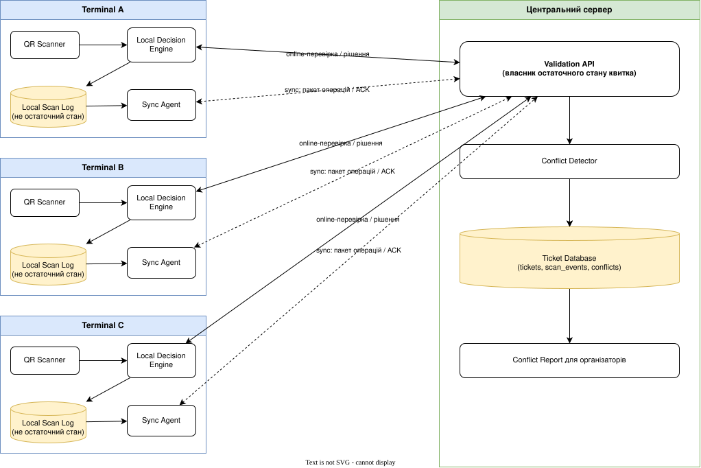
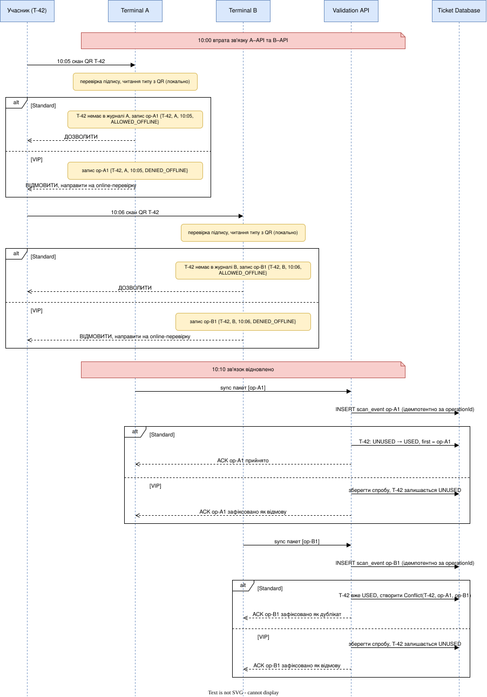

# Практична робота 7. Distributed Systems: проєктування за умов часткової недоступності вузлів

## Припущення

1. QR-квиток містить підписаний payload `{ticketId, type}` (type = Standard або VIP). Термінал має публічний ключ і може перевірити підпис та прочитати тип без зв'язку із сервером.
2. Термінал має локальний постійний append-only журнал сканувань і може мати локальний знімок даних (наприклад, список відкликаних квитків) на момент останньої синхронізації. Цей знімок може бути застарілим.
3. Під час network partition термінали A і B не можуть обмінюватися даними ні із сервером, ні один з одним.
4. Кожне сканування має унікальний `operationId`, який термінал генерує локально.
5. Для VIP заборона повторного проходу не скасовується жодним з припущень.

---

## Рівень 60

### 1. Component Diagram

**Ownership.** Остаточний стан квитка (UNUSED / USED) належить Validation API; це єдиний компонент, що записує його в Ticket Database. Локальні журнали терміналів зберігають лише факти сканувань і рішень, прийнятих терміналом; вони стають частиною остаточного стану лише після синхронізації та обробки сервером. Рішення про прохід приймає Local Decision Engine терміналу (на основі підпису, типу квитка, власного журналу) або Validation API, коли мережа доступна.

### 2. Поведінка для Standard і VIP

| Тип      | Мережа доступна                                                                                                       | Мережа недоступна                                                                                                                                 | Рішення термінала                                           | Які дані зберегти                                                                                                         | Залишковий ризик                                                                                                      |
| -------- | --------------------------------------------------------------------------------------------------------------------- | ------------------------------------------------------------------------------------------------------------------------------------------------- | ----------------------------------------------------------- | ------------------------------------------------------------------------------------------------------------------------- | --------------------------------------------------------------------------------------------------------------------- |
| Standard | Термінал надсилає скан у Validation API; API атомарно перевіряє й оновлює стан: перший скан → ALLOW, повторний → DENY | Термінал перевіряє підпис і тип; якщо квитка немає у власному журналі, дозволяє прохід; якщо вже є, відмовляє                                     | Online: рішення API. Offline: ALLOW за локальною перевіркою | `operationId`, `ticketId`, `terminalId`, локальний timestamp, локальний порядковий номер, рішення, режим (online/offline) | Повторний прохід на іншому терміналі під час partition; прохід не скасувати, конфлікт виявляється після синхронізації |
| VIP      | Термінал надсилає скан у Validation API; API атомарно перевіряє й оновлює стан: UNUSED → USED, ALLOW; інакше DENY     | Термінал не може підтвердити унікальність, тому автоматично не дозволяє прохід: DENY і перенаправлення на online-перевірку (термінал із зв'язком) | Online: рішення API. Offline: DENY (fail-closed)            | Ті самі поля; рішення `DENIED_OFFLINE`                                                                                    | Дубльованого проходу немає; ризик — затримка законного VIP-учасника                                                   |

**Чому гарантії різні.** Для Standard організатори допускають ризик дубльованого проходу, тому пріоритет має доступність: прохід дозволяється офлайн, а конфлікти виявляються пізніше. Для VIP повторне використання заборонене, тому пріоритет має коректність: якщо унікальність не можна підтвердити, прохід не дозволяється.

---

## Рівень 75

### 1. Network partition та відновлення

**Результат сканувань.**

- Standard: обидва проходи вже відбулися (A о 10:05, B о 10:06). Після синхронізації T-42 має стан USED, `first = op-A1`, створено запис Conflict(T-42, op-A1, op-B1), який потрапляє у звіт для організаторів.
- VIP: обидва проходи відхилені; T-42 залишається UNUSED. Учасник проходить після online-перевірки (наприклад, на терміналі C, який має зв'язок) — API атомарно змінює стан UNUSED → USED.

**Порядок синхронізації.** Сервер обробляє пакети в порядку надходження (A, потім B). Порядок надходження не впливає на виявлення конфлікту; він визначає лише, яка операція позначена як `first`.

### 2. Conflict detection

**Дані для виявлення дублікатів.** Для кожного сканування: `operationId` (унікальний ключ, забезпечує ідемпотентність при повторній відправці), `ticketId`, `ticketType`, `terminalId`, локальний фізичний timestamp, локальний порядковий номер терміналу, рішення (`ALLOWED_ONLINE`, `ALLOWED_OFFLINE`, `DENIED_ONLINE`, `DENIED_OFFLINE`), час отримання сервером. На сервері: таблиця `tickets(ticketId, type, status, firstOperationId, firstTerminalId)` та таблиця `scan_events`.

**Правило виявлення.** Якщо для одного `ticketId` існує більше однієї події з рішенням `ALLOWED_*` (включно з випадком, коли квиток уже був дозволений online до або під час partition), Conflict Detector створює запис Conflict зі списком усіх таких `operationId`. Подія з уже відомим `operationId` ігнорується як повторна відправка. Правило визначається кількістю дозволених проходів, а не їх порядком.

**Чи достатньо фізичного timestamp.** Для виявлення конфлікту timestamp не потрібен. Для визначення порядку (яка операція `first`) фізичного timestamp недостатньо: годинники терміналів не синхронізовані, а різниця у 1 хвилину (10:05 і 10:06) порівнянна з можливим дрейфом. Тому timestamp використовується лише як інформаційне поле для звіту, а при співпадінні або сумніві порядок визначається за часом отримання сервером і `terminalId`.

**Lamport Clock / Vector Clock.** Не потрібні. Операції на A і B конкурентні (термінали не обмінювалися повідомленнями), а виявлення конфлікту не вимагає порядку: достатньо `ticketId` + `operationId` + `terminalId`. Логічні годинники не додають жодної вимоги, яку не покривають ці поля, тому не вводяться.

**Межі знань термінала.** Термінал приймає рішення лише за даними, які в нього є: підпис і тип у QR, власний журнал, знімок на момент останньої синхронізації. Він не знає про сканування T-42 на іншому терміналі під час partition.

---

## Рівень 90

### 1. Таблиця архітектурних рішень

| Принцип                     | Рішення у вашій схемі                                                                                                                                                                          | Гарантія / поведінка                                                                                                                                     | Trade-off / обмеження                                                                                                                                                                                                                                |
| --------------------------- | ---------------------------------------------------------------------------------------------------------------------------------------------------------------------------------------------- | -------------------------------------------------------------------------------------------------------------------------------------------------------- | ---------------------------------------------------------------------------------------------------------------------------------------------------------------------------------------------------------------------------------------------------- |
| Independent Failure         | Термінали автономні: власні Decision Engine, Local Scan Log, перевірка підпису. Validation API, Conflict Detector і Ticket Database є окремими компонентами                                    | Відмова зв'язку, терміналу або API не зупиняє інші термінали; Standard продовжує працювати offline; VIP у разі невизначеності відхиляється (fail-closed) | Операції, ще не синхронізовані, зберігаються лише локально: втрата терміналу означає втрату журналу (потрібен постійний носій)                                                                                                                       |
| Network Communication       | Online-перевірка — запит-відповідь із timeout; після таймауту сервер вважається недоступним. Sync Agent надсилає пакети асинхронно з повторами, `operationId` робить обробку ідемпотентною     | Повторна відправка не створює дублікатів у `scan_events`; доставка at-least-once з ефектом exactly-once                                                  | Timeout не відрізняє повільний сервер від недоступного, тому термінал діє консервативно; якщо відповідь API втрачена, VIP може бути позначений USED без проходу (відмова у безпечний бік); конфлікти виявляються із затримкою до відновлення зв'язку |
| Distributed State           | Остаточний стан (UNUSED/USED) — у Ticket Database, єдиний записувач — Validation API. Термінали мають локальний журнал і знімок, які не є остаточними                                          | Один авторитетний стан; локальні дані зводяться до нього після синхронізації (eventual consistency)                                                      | Локальні знімки можуть бути застарілими; стан існує в двох виглядах (локальний і центральний)                                                                                                                                                        |
| Concurrency                 | Online: Validation API виконує атомарну умовну зміну UNUSED → USED (або unique constraint)                                                                                                     | Online на всіх трьох терміналах для одного квитка проходить лише одне сканування зі статусом ALLOWED. Offline конкурентність неминуча                    | Серіалізація на рівні рядка квитка (при 2 000 квитків навантаження мале); offline конкурентні записи вирішуються лише після sync                                                                                                                     |
| Coordination & Ordering     | Координації між терміналами немає. Конфлікт виявляється за множиною подій (`ticketId`, `operationId`, `terminalId`), без залежності від порядку; порядок `first` — за часом отримання сервером | Виявлення конфлікту не залежить від порядку надходження пакетів і від годинників терміналів                                                              | Позначка `first` при розбіжності годинників наближена; якщо знадобиться причинний порядок, потрібні логічні годинники                                                                                                                                |
| Consistency vs Availability | Standard: дозволяє прохід offline, згодом eventual consistency. VIP: відхиляє прохід, якщо не може підтвердити унікальність                                                                    | Standard: доступність, можливі дублікати, всі виявляються. VIP: відсутність повторного проходу                                                           | Standard: допускається повторний прохід. VIP: втрата доступності, коли зв'язку немає (затримка законних учасників)                                                                                                                                   |

### 2. Межі гарантій

Одночасно дозволяти VIP-прохід offline на двох ізольованих терміналах і гарантувати відсутність повторного використання **не можна**. Під час partition кожен термінал приймає рішення лише за локальними даними. Для терміналу A ситуація «квиток уже відсканували на B» нічим не відрізняється від ситуації «на B квиток не сканували», тому без додаткової координації або додаткових обмежень один з двох варіантів неминучий: або відмовити (втрата доступності), або дозволити з ризиком дубліката (втрата гарантії). Це наслідок вибору між consistency і availability у разі network partition.

**Виявлення після синхронізації не є запобіганням.** Sync і Conflict Detector виявляють, що квиток було використано двічі, але вже після того, як обидва проходи відбулися. Для VIP це неприйнятно, тому в основному рішенні VIP не дозволяються offline.

**Додаткове обмеження: закріплення VIP-квитків за терміналом.** Кожен VIP-квиток закріплюється за одним конкретним терміналом. VIP-квиток дозволяється лише на конкретному терміналі, в будь-якому режимі (online і offline); на інших терміналах він відхиляється з перенаправленням. Тоді єдиним місцем, де квиток може бути дозволений, є журнал конкретного терміналу, і гарантія унікальності виконується локально, без координації. Наслідки:

- VIP можуть пройти лише через свій термінал: черги й нерівномірне навантаження;
- якщо конкретний термінал вийшов з ладу, його VIP не можуть пройти, доки призначення не змінене через online-перепризначення (потребує зв'язку із сервером);
- локальний журнал конкретного терміналу стає критичним: його втрата призводить до втрати гарантії, тому потрібен надійний постійний носій і резервування;
- потрібен процес перепризначення, який не допускає двох терміналів для одного квитка одночасно.

---

## Рівень 100

### Альтернативний варіант: закріплення VIP-квитків за домашнім терміналом

**Опис.** Основний варіант: VIP offline відхиляються (fail-closed). Альтернативний варіант: кожен VIP-квиток закріплений за конкретним терміналом, який є єдиним власником права дозволити прохід цього квитка (online і offline). Validation API зберігає таблицю призначень і отримує факти проходів через sync; Standard працює, як в основному варіанті.

**Гарантії для VIP.** В основному варіанті повторного проходу немає за рахунок відмови без підтвердження, при цьому законні VIP під час partition не проходять. В альтернативному повторного проходу немає за умови, якщо збережено локальний журнал конкретного терміналу і виконання правила «лише на конкретному терміналі».

**Частка доступних offline-операцій.** Основний варіант: Standard — 100 %, VIP — 0 %. Альтернативний: Standard — 100 %, VIP — 100 % на конкретному терміналі і 0 % на інших.

**Складність синхронізації.** Основний варіант: Sync Agent надсилає журнал, сервер виявляє конфлікти лише для Standard. Альтернативний: для VIP конфліктів не виникає (єдиний записувач на квиток), але потрібен протокол перепризначення конкретного терміналу, що вимагає зв'язку й захисту від подвійного призначення.

**Вартість експлуатації.** Основний варіант дешевший: термінали прості, стан VIP не зберігається локально, чергу для VIP у разі partition обробляє персонал. Альтернативний дорожчий: потрібні надійне збереження та резервування журналу кожного терміналу, керування призначеннями, обробка збою конкретного терміналу, балансування черг.

**Зміна вимог, за якої альтернативний варіант доцільніший.** Якщо вимога змінюється так: «VIP повинні проходити без перенаправлення навіть при втраті зв'язку з сервером на понад 15 хвилин, а повторне використання квитка залишається забороненим», основний варіант перестає її задовольняти, оскільки VIP не проходять взагалі, а альтернативний виконує її за рахунок закріплення за терміналом.
